# High-Frequency Limit Order Book Alpha & Microstructure Execution Engine

[](https://colab.research.google.com/github/aaravsin-1/ML_Project_2026/blob/master/notebooks/colab_run_all.ipynb)
[](tests/)
[-teal.svg)](app/)
[](setup.py)
[](src/models/)
[](cpp/)
[-crimson.svg)](LICENSE)

A leakage-controlled empirical research and deployment framework asking two tightly coupled questions: **(1) How predictable are short-horizon mid-price movements from multi-level Limit Order Book (LOB) and companion derivatives order flow?** and **(2) When can a trading or execution system survive spread crossing, queue adverse selection, latency decay, and exchange statutory costs?**

Across **43+ million snapshots on 6 real and benchmark datasets** — anchored by **`36.0 million` 1-second 5-level snapshots across `25` Indian NSE cash & index-futures instruments (`64` full trading days) plus `12` matched Single-Stock Futures (`SSF`) books** alongside **Coinbase BTC-USD**, **Nasdaq LOBSTER**, **FI-2010**, and **two Optiver Kaggle competitions** — the framework spans:
- **Causal microstructure feature engineering** (`25` core L1–L5 imbalance / VPIN / micro-price / PCA-MLOFI features → `38` multi-scale drift/volatility/`day_progress` `v2` features → `46` features adding `8` companion `SSF → Cash` lead-lag & basis signals);
- **A complete model hierarchy & Flagship Hybrid** (`Naïve Baselines → Logistic Regression → Random Forest → Multi-Horizon 10s/20s LightGBM + 100s Dual-Attention TLOB Transformer with Adaptive BiN → C++20 10.5 µs inference engine`);
- **Strict out-of-universe & statistical verification** (`22` untouched NSE instruments, `10` unseen SSF equities, `10`-point ML completeness audit with per-class F1/MCC/ECE/confusion matrices, moving-block bootstraps, Wilcoxon signed-rank & McNemar tests);
- **An execution cost & latency simulator** (`Taker`, `3-mode Passive Maker`, and **`LOB-Hybrid 2.0 (+SSF)`** TWAP overlay);
- **Live web deployment (`LOB Alpha Studio`)** powered by FastAPI, real-time 46-feature inference, `TreeSHAP`, and Docker.

### Key Deliverables & Entry Points

| Deliverable | What It Is | Where to Look |
| :--- | :--- | :--- |
| **LOB Alpha Studio (Live App)** | Interactive 5-tab FastAPI + LightGBM + TLOB + TreeSHAP web terminal | [`app/`](app/README.md) · [`run_dashboard.bat`](run_dashboard.bat) · [`Dockerfile`](Dockerfile) |
| **25-Stock Verification & ML Audit** | Error anatomy, `IDEA` shock forensics, `K=1..8` ensembles, `N=1..100` averaging, `SSF→Cash`, `25`-stock & `10`-point ML audit | [`submission/ADDITIONAL_EXPERIMENTS_AND_VERIFICATION.md`](submission/ADDITIONAL_EXPERIMENTS_AND_VERIFICATION.md) |
| **LaTeX Technical Report & Slides** | Full compiled PDF report and 22-slide ML presentation deck | [`report/LOB_ML_Project_Report.pdf`](report/LOB_ML_Project_Report.pdf) · [`report/LOB_ML_Project_Presentation.pptx`](report/LOB_ML_Project_Presentation.pptx) |
| **Summary Report & Final Notebook** | Course summary report and executable Colab submission notebook | [`submission/PROJECT_REPORT.md`](submission/PROJECT_REPORT.md) · [`submission/Final_Project_Notebook.ipynb`](submission/Final_Project_Notebook.ipynb) |
| **Phases 1–4 NSE Execution Compendium** | Execution cost savings (`LOB-Hybrid 2.0`), 6-probe kill-switches, & 2015–2026 event verification | [`NSE_ALPHA_AND_EXECUTION_MASTER_RESEARCH.md`](NSE_ALPHA_AND_EXECUTION_MASTER_RESEARCH.md) |
| **Plain-English Guides & Literature** | Step-by-step explainers and surveyed LOB ML bibliography | [`docs/learn/README.md`](docs/learn/README.md) · [`research_notes/PAPER_LITERATURE_AND_REFERENCES.md`](research_notes/PAPER_LITERATURE_AND_REFERENCES.md) |

---

### Headline Findings on Real Data

- **25-Stock NSE Out-of-Universe Generalization (`36.0M` rows, `6.71M` held-out test seconds):** Freezing all `38` `v2` formulas, `10s+20s` Multi-Horizon averaging, and LightGBM hyperparameters on `3` development benchmarks (`RELIANCE`, `NIFTY_FUT`, `IDEA`) and evaluating unchanged across **`22` strictly unseen NSE instruments** wins **`22/22` (`100%`, Wilcoxon `p = 2.38 × 10⁻⁷`)**: Macro-F1 rises `+6.23 pp` (`0.4421 → 0.5044`), mean ROC-AUC reaches **`0.7012`**, mean directional hit rate reaches **`65.49%`** (`62.9%–75.6%`), **`300 / 300` full held-out trading days** exceed `55%` (worst single day: `58.84%`), non-overlapping Batch-100 session majority win rate averages **`92.2%`**, and every instrument passes 3-class health (`global min per-class F1 = 0.3837 > 0.20`).
- **Single-Stock Futures Lead Cash (`SSF → Cash`, `12/12` Equities):** Injecting `8` strictly causal features from each stock's companion Single-Stock Futures 5-level book (imbalances, 30-min causally demeaned basis, `1s/5s` returns, and `5s/15s` futures-minus-cash lead) lifts held-out Macro-F1 on **`12/12` (`100%`) equities** (`10/10` unseen, Wilcoxon `p = 9.77 × 10⁻⁴`) and **`48/48` symbol-segments** even after residualizing market (`NIFTY_FUT`) and equal-weight sector flow (`+0.0712` ΔIC at 5 s, twice as strong as `Cash → SSF`). Applying the exact same 8 formulas from companion `BANKNIFTY_FUT` also lifts `NIFTY_FUT` (`0.4729 → 0.4754` F1).
- **The Tick-Size Predictability vs. Tradability Paradox (`r = +0.80` vs. Negative Taker P&L):** Across all `25` NSE instruments (`5` tick regimes from `0.035 bp` on `BANKNIFTY_FUT` to `7.41 bp` on `IDEA`), short-horizon predictability scales log-linearly with relative tick size (`r = +0.80`, `IDEA` `75.6%` DirHit / `0.773` AUC), **yet** spread crossing + 1 s delay leaves standalone taker round-trips negative on **all 25 NSE instruments** (`-0.97` to `-6.66 bps` gross before `3.5–5.6 bps` statutory fees) and **Coinbase BTC-USD** (`+0.70 bp` best filtered gross vs `8 bp` round-trip taker fees). Turning LOB prediction into net alpha requires shifting from aggressive standalone trading to **execution timing (`LOB-Hybrid 2.0 (+SSF)` beats TWAP by `+0.31` to `+0.67 bps` on `12/12` OOS days)**.
- **Error Anatomy, Closing-Stall Fix & Cross-Paradigm Hybrid (`10.5 µs` C++ Trees + `100s` `TLOB`):** Across 25 NSE stocks, **`63.4%` of all 3-class mistakes** are harmless `±α` dead-zone boundary calls (`1.20× α` median miss on `RELIANCE`, `87.5%` on `IDEA`), while an off-book institutional sweep forensic case study (`IDEA`, `₹1.15 Cr` sweep in 18 s) demonstrates the single-book Bayes-error ceiling. Adding realized volatility + `day_progress` (`v2`) fixed a `15:15–15:30 IST` closing-stall artifact (**`53.4% → 84.8%` accuracy on `RELIANCE`, `+31.4 pp`**). Blending `46f` Multi-Horizon LightGBM with the `100s` `TLOB` Dual-Attention Transformer (`Adaptive BiN`) lifts `RELIANCE` to **`0.5159` Macro-F1 / `0.7080` ROC-AUC / `0.0056` ECE** (`80.7%–89.4%` accuracy at `τ ≥ 0.60–0.65`) while surviving a `+10.7%` NIFTY rally where `LSTM` suffers class collapse (`FLAT F1 = 0.1794`).
- **History-vs-Architecture Crossover (`FI-2010`) & Microstructure Bounds (`LOBSTER`, `BTC`, `Optiver`):** On **FI-2010** (`k=10`), giving `Logistic Regression` the same lagged book history flips it above `DeepLOB` (`86.1%` vs `83.1%`), whereas `DeepLOB` wins clearly at `k=50, 100`. On **Coinbase BTC** (`15` levels, `20 s`), `LightGBM` (`0.467 ± 0.021` F1) outperforms `DeepLOB` (`0.401`) on `4/4` segments (`p < 0.0001`), while `ETH` order flow adds `+0.016` F1 (`10 s`). On **Nasdaq LOBSTER (`100 ms`)**, queue position governs passive market making (`+0.7` to `+1.2 bp` at front of queue vs `-2 bp` at back) and Stoikov's micro-price gap matches LightGBM on large-tick stocks (yet fails as a training target in `21/37` cases). On **Optiver Realized Volatility**, past-only nearest neighbours retain only **`59%`** of the leaky 1st-place feature gain.

### Research spec coverage

Map from the original research design ([`project_research.md`](project_research.md)) through the NSE 25-stock and web-app extensions:

| Spec section | What it asks | Where it is answered | Status |
|:---|:---|:---|:---|
| 1 | Large-tick vs small-tick predictability | [NSE 5-Regime Verification](#indian-nse-25-instrument-microstructure-ssf-lead-lag--out-of-universe-verification), [LOBSTER](#lobster-nasdaq-event-data-large--vs-small-tick-stocks-experiment-i), [BTC Market Making](#btc-market-making-with-an-adverse-selection-model-experiment-h) | Done (`25` NSE + `5` LOBSTER + BTC) |
| 2 | Multi-exchange LOBs & leak-free normalization | All 6 real datasets; train-only normalizers & `Adaptive BiN`; [`nse_pipeline.py`](src/microstructure/nse_pipeline.py) | Done (`43.0M+` snapshots) |
| 3 | OFI, MLOFI + PCA, VPIN, micro-price, multi-scale `v2`, cross-market `SSF` | Core `25f` → `v2 38f` → `+SSF 46f` features; [Experiment K](#micro-price-as-a-target-experiment-k) | Done (`+SSF` `12/12` equities) |
| 4.1 / 5.2 | Horizons from `100 ms` to `100 s` and decay curves | Synthetic B, BTC B, LOBSTER (`100 ms–30 s`), NSE Multi-Horizon `10s–100s` | Done |
| 4.2 | Model ladder (Tiers 0–5 + Flagship Hybrid) & `K=1..8` subsets | NSE, BTC, FI-2010, Synthetic; [Additional Experiments §4](submission/ADDITIONAL_EXPERIMENTS_AND_VERIFICATION.md#4-why-models-disagree--why-cross-paradigm-ensembles-win-k--18) | Done |
| 5.1 | Statistical significance, per-class `F1`, `3×3` CMs, calibration (`ECE`, `MCC`) | Wilcoxon/Binomial/McNemar/Block-Bootstrap tests; [Additional Experiments §6–7](submission/ADDITIONAL_EXPERIMENTS_AND_VERIFICATION.md) | Done (`22/22` unseen, `300/300` days) |
| 5.3 | Ablations, `TreeSHAP`, & neural attribution | [BTC Experiment J](#btc-attribution-and-significance-experiment-j), [NSE `TreeSHAP` Audit](submission/ADDITIONAL_EXPERIMENTS_AND_VERIFICATION.md#76-upgraded-feature-attribution-treeshap--gain--complete-model-complexity-ledger-v2_ssf_feature_importancecsv) | Done |
| 6.1–6.2 | Spread crossing, statutory costs, latency, passive fills & TWAP savings | BTC D/E/H, LOBSTER I, NSE Taker/MM, and [`LOB-Hybrid 2.0`](NSE_ALPHA_AND_EXECUTION_MASTER_RESEARCH.md) | Done (`+0.31–0.67 bps` vs TWAP) |
| 7 | Low-latency C++ system & live web deployment | [`C++20 Benchmark`](#c20-latency-benchmark) (`10.5 µs` exact parity) + [`LOB Alpha Studio`](#lob-alpha-studio--live-interactive-web-terminal) | Inference & Live UI Done (feed handler future work) |
| 8 | Regimes where predictability / execution edge holds | [BTC Experiment G](#btc-does-the-edge-survive-in-any-regime-experiment-g), NSE selective conviction (`τ≥0.60–0.65`) & `VolGate` | Done |

---

## Table of Contents
1. [LOB Alpha Studio — Live Interactive Web Terminal](#lob-alpha-studio--live-interactive-web-terminal)
2. [Core Architecture](#core-architecture)
3. [Mathematical Foundations & Microstructure Signals](#mathematical-foundations--microstructure-signals)
4. [Model Hierarchy (Tiers 0–5 & Flagship Hybrid)](#model-hierarchy-tiers-05--flagship-hybrid)
5. [Methodology: Leakage Controls](#methodology-leakage-controls)
6. [Real-Data Results](#real-data-results)
   - [Indian NSE: 25-Instrument Microstructure, SSF Lead-Lag & Out-of-Universe Verification](#indian-nse-25-instrument-microstructure-ssf-lead-lag--out-of-universe-verification)
   - [Coinbase BTC-USD, LOBSTER, FI-2010 & Optiver Benchmarks](#coinbase-btc-usd-experiments-ad)
7. [Synthetic-Data Results](#synthetic-data-results)
8. [C++20 Latency Benchmark](#c20-latency-benchmark)
9. [Repository Structure](#repository-structure)
10. [Running on Google Colab](#running-on-google-colab)
11. [Installation & Local Quickstart](#installation--local-quickstart)
12. [Automated Test Suite](#automated-test-suite)
13. [Known Limitations](#known-limitations)
14. [References](#references)
15. [License](#license)

---

## LOB Alpha Studio — Live Interactive Web Terminal

[`app/`](app/README.md) packages the trained **46-feature Flagship Hybrid** (`38f LightGBM v2 + 8f Companion Futures + Multi-Horizon 10s/20s + TLOB`), live **TreeSHAP** explanations, and all 25-stock NSE audit tables into a zero-dependency-mount FastAPI web terminal (`~35 MB` bundle):

```bash
pip install -r requirements-app.txt
python -m app.server --port 8050       # or double-click run_dashboard.bat
# Open http://127.0.0.1:8050
```

- **Docker / Cloud Ready:** Build with [`Dockerfile`](Dockerfile) (`PORT=7860`, slim Python 3.12 + `libgomp1`).
- **5 Interactive Views:**
  1. **Live Order Book Replay:** 1-second 5-level depth + mid-price trajectory across `RELIANCE`, `NIFTY_FUT`, `NIFTY_FUT` Seg-3 Shift, and `IDEA`, comparing `Flagship Hybrid` vs `LightGBM v2/v1`, `TLOB`, `DeepLOB5`, and `LSTM` with jump-to-regime presets (`+SSF Futures Rescue`, `v2 Fixes Old Error`, `TLOB Wins (100s)`, `LGBM Wins (1s Flip)`, `±α Boundary Trap`).
  2. **Interactive Book Sandbox (`+SSF`):** Edit L1–L5 bids/asks, spreads, and companion futures inputs live to inspect real-time 46-feature class probabilities and per-prediction `TreeSHAP` waterfall drivers.
  3. **25-Stock Universe & Tick-Regime Explorer:** Filter all `25` NSE instruments (`22` untouched out-of-universe) and `12` `SSF → Cash` equities across 5 tick regimes (`0.035 bp` to `7.41 bp`).
  4. **Model Ladder & Ensembles:** Inspect `K = 1..8` subset searches, `N = 1..100` averaging curves, error anatomy, and `10.5 µs` C++ vs GPU CUDA latency.
  5. **ML Evaluation & Audit:** Interactive split priors, per-class `Precision/Recall/F1` reports, `3×3` confusion matrices, `MCC/ECE` calibration, Train–Val–Test gaps, and `TreeSHAP` rankings.

---

## Core Architecture

```
   +-----------------------------------------------------------------------+
   | Multi-Market LOB Ingestion (Whole-Day / Chronological Purged Splits)  |
   | • Indian NSE (36.0M 1s×5lvl: 25 Cash/Index + 12 SSF + BANKNIFTY_FUT) |
   | • BTC-USD (15lvl), Nasdaq LOBSTER (100ms), FI-2010, Optiver, Synthetic|
   +-----------------------------------+-----------------------------------+
                                       |
         +-----------------------------+-----------------------------+
         v                                                           v
+----------------------------------------+      +-----------------------------------+
| Branch A: 46 Causal Features           |      | Branch B: Raw LOB Sequence        |
| • 25 Core (OFI, L1-L5 Imb, MLOFI PCA,  |      |   100s × 20 (5-level Bids/Asks)   |
|   VPIN, Micro-price, Slopes, Lags)     |      |   • Decimal Precision Norm        |
| • +13 v2 (5-60s Drift, Vol, day_prog)  |      |   • Adaptive Bilinear Norm (BiN)  |
| • +8 Cross-Market (+SSF / Companion    |      +-----------------+-----------------+
|   Futures Basis & 5s/15s Lead-Lag)     |                        |
+--------------------+-------------------+                        v
                     |                          +-----------------------------------+
                     v                          | Sequence Encoders (GPU)           |
+----------------------------------------+      | • TLOB (Dual-Attention Transformer|
| Tabular & Multi-Horizon Models         |      | • DeepLOB5 / LSTM                 |
| • LogReg, Random Forest                |      +-----------------+-----------------+
| • LightGBM v2[+SSF] (k=10s & 20s avg)  |                        |
| • C++20 Zero-Diff Codegen (10.5 µs)    |                        |
+--------------------+-------------------+                        |
                     +-------------------+------------------------+
                                         | LOSO Out-of-Fold Convex Blend
                                         v (FLAT / UP / DOWN + Calibrated Probs)
   +-----------------------------------------------------------------------+
   | Downstream Verification, Execution & Deployment                       |
   | • Execution Sim: Taker / 3-Mode Passive Maker / LOB-Hybrid 2.0 (TWAP) |
   | • 10-Point ML Audit, TreeSHAP, Wilcoxon / McNemar / Block Bootstrap   |
   | • Live FastAPI Terminal (LOB Alpha Studio — app/server.py)            |
   +-----------------------------------------------------------------------+
```

---

## Mathematical Foundations & Microstructure Signals

### 1. Limit Order Book Dynamics
At event or snapshot time $`t`$, the top $`M`$ levels ($`M = 5`$ on NSE, $`10`$ on LOBSTER/FI-2010, $`15`$ on BTC) of the book are:

$$
LOB(t) = \left\lbrace \bigl(p_m^a(t),\, q_m^a(t),\, p_m^b(t),\, q_m^b(t)\bigr) \right\rbrace_{m=1}^{M}
$$

with spread $`S(t) = p_1^a(t) - p_1^b(t)`$ and mid-price $`P_{\mathrm{mid}}(t) = \tfrac{1}{2}\bigl(p_1^a(t) + p_1^b(t)\bigr)`$. All rolling windows, lags, returns, and basis demeanings reset cleanly at `09:15:00 IST` on NSE so signals never cross overnight gaps.

### 2. Order Flow Imbalance (OFI & MLOFI)
Following **Cont, Kukanov, and Stoikov (2014)**, the bid-side demand change is:

$$
\Delta W(t) = \begin{cases}
q_1^b(t), & p_1^b(t) > p_1^b(t-1) \\
q_1^b(t) - q_1^b(t-1), & p_1^b(t) = p_1^b(t-1) \\
-q_1^b(t-1), & p_1^b(t) < p_1^b(t-1)
\end{cases}
$$

The ask-side supply change $`\Delta V(t)`$ is defined symmetrically, and $`OFI(t) = \Delta W(t) - \Delta V(t)`$. Following **Cont, Cucuringu, and Zhang (2023)**, **Multi-Level OFI** applies the same formula across deeper book levels and compresses the multi-level vector via **PCA fitted strictly on the training split** into `ofi_pca1..3`.

### 3. Volume-Synchronized Probability of Informed Trading (VPIN)
Following **Easley, López de Prado, and O'Hara (2012)**, trades are grouped into buckets of constant volume $`V`$, and:

$$
VPIN = \frac{\sum_{\tau=1}^{N} \left| V_\tau^B - V_\tau^S \right|}{N \times V}
$$

VPIN is computed from trade volume / signed flow and mapped onto each snapshot strictly causally using only buckets completed at or before timestamp $`t`$.

### 4. The Micro-Price Estimator
Following **Stoikov (2018)**, with $`I(t) = \frac{q_1^b - q_1^a}{q_1^b + q_1^a}`$:

$$
P_{\mathrm{micro}}(t) = \frac{q_1^b p_1^a + q_1^a p_1^b}{q_1^b + q_1^a} = P_{\mathrm{mid}}(t) + \frac{I(t)}{2}\, S(t)
$$

The normalized deviation $`P_{\mathrm{micro}} - P_{\mathrm{mid}}`$ enters as a feature and serves as a standalone single-parameter large-tick benchmark in [Experiment K](#micro-price-as-a-target-experiment-k).

### 5. Spread Feature
The spread enters as an integer number of ticks. An earlier version used relative spread $`S / P_{\mathrm{mid}}`$; with a fixed one-tick spread this collapsed to a monotone proxy of the price level, so float32 rounding leaked regime identity and was removed cleanly.

### 6. Normalization
- **Decimal precision normalization** for `LSTM` and `DeepLOB`: $`(P - P_0)/P_0`$ and $`\log(1 + V/V_0)`$ fitted on training snapshots.
- **Bilinear Normalization (`BiN`)** (**Tran et al., 2021**) inside **`TLOB`** ([`normalizers.py`](src/data/normalizers.py)), protecting attention weights during strong regime shifts such as `NIFTY_FUT` Segment 3's `+10.7%` rally.

### 7. Multi-Scale Flow, Realized Volatility & Intraday Seasonality (`LightGBM v2`, `38` Features)
Diagnostic error analysis exposed a 5-second lookback blind spot and a `15:15–15:30 IST` closing-stall artifact where static bid walls fooled `v1` (`53.4%` accuracy). Adding `13` strictly causal features fixes both (`+5.20 pp` F1 across `25/25` NSE instruments):
- **Multi-scale flow & signed drift (`9`):** `mid_drift_{5,15,30,60}s_ticks`, `ofi_mean_{10,30,60}s`, `imb1_mean_20s`, `imb1_vel_20s = imb_l1 - imb1_mean_20s`.
- **Volatility & spread (`3`):** `vol_{10,30}s_ticks` (trailing mean $`|\Delta m_{1s}|/\mathrm{tick}`$), `spread_mean_20s`.
- **Session clock (`1`):** `day_progress = pos_in_day / 22500.0` (`09:15 → 15:30 IST`, raising late-day stall accuracy on `RELIANCE` from `53.4% → 84.8%`).

### 8. Cross-Market Companion Futures Features (`+SSF / +Companion`, `46` Features)
For any equity with a Single-Stock Futures book (or index futures paired with a companion contract such as `NIFTY_FUT ← BANKNIFTY_FUT`), `8` causal futures signals capture leveraged price discovery:
- `ssf_imb_l1`, `ssf_imb_l5`, `ssf_imb1_5s` (futures queue pressure);
- `basis_dev_bp` (raw log basis minus trailing 30-minute intraday causal mean);
- `ssf_ret_1s_bp`, `ssf_ret_5s_bp`, `lead_5s_bp = ssf_ret_5s - cash_ret_5s`, `lead_15s_bp = ssf_ret_15s - cash_ret_15s`.

### 9. The Accuracy–Latency–Cost Break-Even Law
For a directional signal $`s = \pm 1`$ held over horizon $`h`$ with average absolute move $`m`$, inference/wire latency $`L`$, and round-trip friction $`C = c_{\mathrm{cross}} + 2f`$:

$$
\mathrm{net\ edge} = E\bigl[s \cdot \Delta m_{t \to t+h}\bigr] - \mathrm{latency\ decay}(L) - C, \qquad p^* = \frac{1}{2} + \frac{C}{2m}
$$

When round-trip crossing + statutory costs $`C`$ exceed typical horizon move $`m`$ ($`p^* > 100\%`$), **no directional classifier can win as a standalone taker**, shifting the winning deployment to passive/opportunistic execution (`LOB-Hybrid 2.0`).

---

## Model Hierarchy (Tiers 0–5 & Flagship Hybrid)

| Tier | Model | Input / Window | Role |
|:---:|:---|:---|:---|
| **Tier 0** | Naïve Flat / Naïve Momentum | None / realized lag $t-k$ | Majority-class & autocorrelation sanity baselines |
| **Tier 1** | Logistic Regression | Standardized causal vector (`25f–27f`) | Linear baseline (`C = 1.0`, balanced class weights) |
| **Tier 2** | Random Forest | Causal tabular vector (`25f–27f`) | Bagged non-linear tabular baseline |
| **Tier 3** | **LightGBM (`v1` / `v2` / `+SSF`)** | `25f` / `38f` / `46f` + `MH(10s, 20s)` | Fast GBDT flagship branch (`10.5 µs` C++ inference, early stopping on val) |
| **Tier 4** | LSTM | `100 × 4M` raw LOB tensor | Sequential recurrent baseline |
| **Tier 5** | DeepLOB / **TLOB** | `100 × 4M` raw LOB tensor | CNN+Inception+LSTM (**Zhang et al., 2019**); Dual-Attention Transformer + `BiN` (**Berti & Kasneci, 2025**) |
| **★ Flagship** | **46f Multi-Horizon LightGBM + TLOB** | Both branches (`46f` + `100s×20`) | Leave-One-Segment-Out (`LOSO`) convex blend combining `1 s` tree flips + `SSF` lead + `100 s` attention |

Every learned model uses **balanced class weights**, so Macro-F1 is directly comparable across tiers even under ultra-large-tick class imbalance (`IDEA`: `69.4% FLAT`).

---

## Methodology: Leakage Controls

- **Train-only fitting:** Normalizers, `MLOFI PCA` loadings, VPIN bucket scales, and ternary dead-zone thresholds `±α` (`33.3%` quantile of training `|r_k|`) are estimated strictly on the training split. All features at $t$ depend only on timestamps $\le t$.
- **Whole-day & purged chronological splits:** On **NSE**, `64` days per instrument split into `4 × 16`-day contiguous walk-forward segments (`11` Train / `2` Val / `3` Test days = `12` test days, `~268.6k` test seconds/symbol) with full overnight resets. On **BTC / Synthetic**, chronological `70/15/15` splits purge the final `k` boundary rows before each split ([`purged_split_indices`](src/data/lob_dataset.py)).
- **Frozen out-of-universe protocol:** All `v2`, `10s+20s` Multi-Horizon, and `+SSF` formulas and hyperparameters were locked on `3` benchmarks (`RELIANCE`, `NIFTY_FUT`, `IDEA`) and evaluated unchanged on **`22` completely unseen NSE instruments** and **`10` unseen SSF equities**.
- **Rigorous statistical inference & tests:** Moving-block bootstraps (preserving intraday autocorrelation), McNemar's test, exact Wilcoxon signed-rank & binomial sign tests across the 25-stock cross-section, permutation negative controls (`IC = -0.0005` over `37` runs), and **`43` automated unit & pipeline tests** ([`tests/`](tests/)).

---

## Synthetic-Data Results

> These results are on the synthetic generator. It plants a hidden "informed trader" state that persists for 15–60 events and skews order flow, so any predictability found here is the predictability built into it. For real markets, see [Real-Data Results](#real-data-results).

Reproduce with `python scripts/run_all_experiments.py` (about 8 minutes on a CUDA GPU). Per-seed rows are in `artifacts/*_per_seed.csv`.

### Experiment A: Model Hierarchy (k = 20)

| Tier | Model | Accuracy | Macro-F1 | Cross-Entropy |
|:---:|:---|:---:|:---:|:---:|
| 0 | Naïve Flat | 0.698 ± 0.013 | 0.274 ± 0.003 | 4.812 |
| 0 | Naïve Momentum (lag k) | 0.645 ± 0.012 | 0.519 ± 0.013 | 0.961 |
| 1 | Logistic Regression | 0.587 ± 0.011 | 0.564 ± 0.008 | 0.812 |
| 2 | Random Forest | 0.609 ± 0.008 | 0.578 ± 0.008 | 0.757 |
| 3 | **LightGBM** | 0.620 ± 0.014 | **0.584 ± 0.012** | **0.743** |
| 4 | LSTM | 0.552 ± 0.049 | 0.521 ± 0.023 | 0.859 |
| 5 | DeepLOB | 0.597 ± 0.025 | 0.559 ± 0.010 | 0.823 |
| 5 | TLOB | 0.535 ± 0.026 | 0.492 ± 0.018 | 0.965 |

Accuracy is below the Naïve Flat rate for every learned model because balanced class weights trade majority-class accuracy for recall on UP/DOWN. Macro-F1 is the comparison metric. On this data, sequence models do not beat the tabular models built on hand-crafted microstructure features. The deep nets also train for at most 10 epochs, so they may be under-trained.

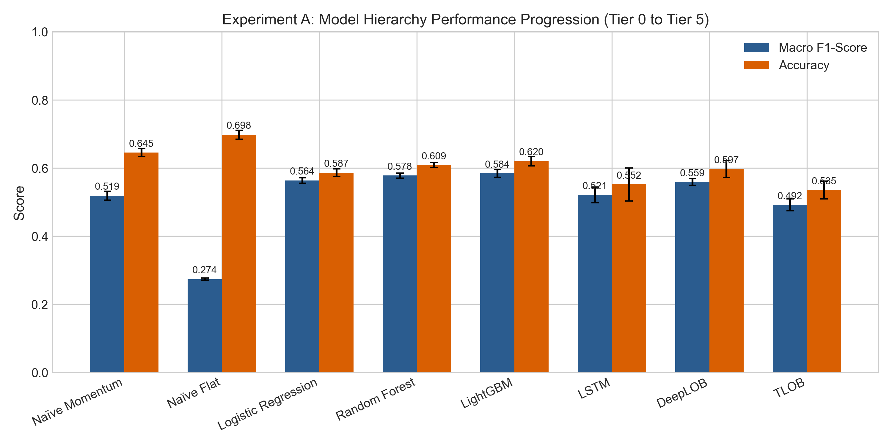

### Experiment B: Signal Decay Across Horizons (LightGBM)

| Horizon k | Macro-F1 | Naïve Momentum Macro-F1 | Accuracy | Test FLAT share |
|:---:|:---:|:---:|:---:|:---:|
| 10 | 0.521 ± 0.011 | 0.438 | 0.715 | 88.3% |
| 20 | **0.581 ± 0.011** | 0.519 | 0.614 | 69.8% |
| 50 | 0.534 ± 0.012 | 0.467 | 0.542 | 38.7% |
| 100 | 0.453 ± 0.013 | 0.413 | 0.508 | 22.1% |

Skill peaks at k = 20. At k = 10 most moves fall under the 1.5 bp threshold (88% FLAT), which makes UP/DOWN hard to recall. Beyond k = 20 the signal decays. The informed-flow bursts the generator plants last 15–60 events, which matches this shape.

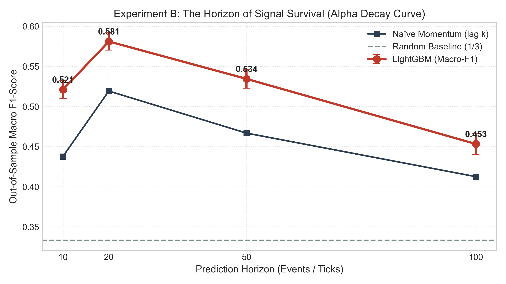

### Experiment C: Feature Ablation (LightGBM, k = 20)

| Feature set | # Features | Macro-F1 |
|:---|:---:|:---:|
| A: Spread only | 1 | 0.160 ± 0.102 |
| B: L1 snapshot (spread, L1 imbalance, L1 OFI, micro-price deviation) | 4 | 0.492 ± 0.011 |
| C: B + lags of L1 signals | 13 | 0.541 ± 0.006 |
| D: C + levels 2–3 (L3 imbalance, L2/L3 OFI) | 16 | 0.570 ± 0.008 |
| E: All features (adds L4–10 depth, slopes, MLOFI PCA, VPIN) | 27 | 0.581 ± 0.011 |

The spread is always one tick in this regime, so Model A carries no information. With balanced weights it collapses to a single class, and which class varies by seed (hence the large std). Short history adds +0.049 on top of the L1 snapshot, and levels 2–3 add +0.029. The rest of the book adds +0.011.

**Feature attribution** (share of total LightGBM split gain on the full model, mean over seeds): `imbalance_l3` 49.3%, `vpin` 7.5%, `ofi_pca1` 6.3%, `slope_bid` 5.3%, `slope_ask` 4.9%, `imbalance_l5` 4.1%, `ofi_lag_1` 4.0%, `imbalance_l1` 3.4%. Gain importance is a model-internal measure. It is not a causal attribution, and it splits credit arbitrarily between correlated features.

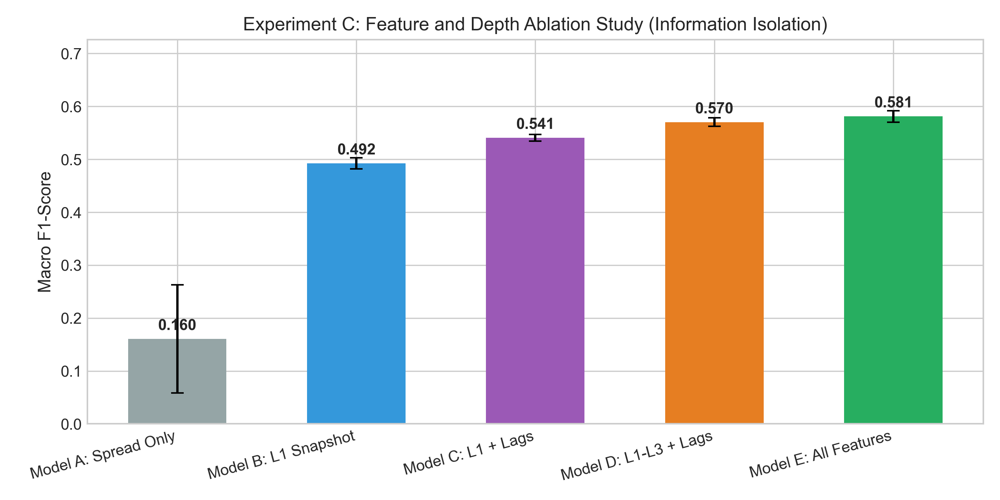

### Experiment D: Execution and Latency

The test-set signals of the trained LightGBM and DeepLOB models from Experiment A are executed over each seed's test window (8,980 events, about 89 s of simulated trading). Settings: \$1M capital, 100-share lots, ±500 share inventory cap, 1.5 bp taker fee, 0.5 bp maker rebate, and 1 ms latency unless stated. Latency is applied in wall-clock time: an order reaches the book at the first snapshot whose timestamp is at least $`t`$ + latency. If an order is larger than the visible depth, by default the simulator extends the book past its last level, using the visible book's average level spacing and level size. It can also be set to fill partially or to reject the order, and it counts how often any of this happens (`overflow_policy` in [simulator.py](src/execution/simulator.py)).

| Model | Regime | Net PnL (\$) | Trades | PnL / trade (\$) | Fees (\$) | Slippage vs decision mid (\$) |
|:---|:---|:---:|:---:|:---:|:---:|:---:|
| LightGBM | Academic mid-price (fantasy) | 1,858 ± 136 | 658 | 2.86 | 0 | 0 |
| LightGBM | Aggressive taker | **457 ± 257** | 658 | 0.74 | 982 | 422 |
| LightGBM | Passive maker (VPIN gate) | 2 ± 31 | 4 | — | −2 | 0 |
| DeepLOB | Academic mid-price (fantasy) | 1,782 ± 142 | 797 | 2.25 | 0 | 0 |
| DeepLOB | Aggressive taker | 104 ± 160 | 797 | 0.14 | 1,186 | 501 |
| DeepLOB | Passive maker (VPIN gate) | 7 ± 173 | 11 | — | −5 | 0 |

- Crossing the spread and paying fees removes about 75% (LightGBM) and 94% (DeepLOB) of the fantasy PnL. DeepLOB's signals flip more often, so it trades more and pays more friction.
- The **passive maker** joins the touch and counts as filled only when the market trades *through* its price within 50 events (it assumes it sits at the back of the queue). It cancels when the signal flips or VPIN exceeds its 90th training-period percentile. Under this conservative rule almost nothing fills, and what does fill is adversely selected by construction. An earlier version assumed every passive order filled instantly at the touch, which is why it used to beat even the fantasy regime.
- **Sharpe ratios are not reported** in these tables. Annualizing about 90 seconds of returns gives numbers in the hundreds or thousands that mean nothing. The CSVs still contain a Sharpe computed on 100 ms bars for relative comparison.

**Latency sweep** (aggressive taker, added latency, net PnL mean ± std):

| Added latency | LightGBM | DeepLOB |
|:---:|:---:|:---:|
| 0 ms | 508 ± 255 | 155 ± 156 |
| 1 ms | 457 ± 257 | 104 ± 160 |
| 2 ms | 454 ± 258 | 100 ± 160 |
| 10 ms | 427 ± 267 | 71 ± 173 |
| 25 ms | 369 ± 265 | 14 ± 181 |
| 100 ms | 119 ± 278 | −247 ± 210 |

**Measured single-sample inference latency** (median, Python): LightGBM booster **0.14 ms** (CPU), DeepLOB **2.4 ms** (CUDA, batch of 1).

Interpretation: both models lose about the same amount per millisecond of latency (≈\$390–400 from 0 to 100 ms). LightGBM's advantage over DeepLOB is already present at zero latency, so it comes from better signals, not faster inference. At the measured latencies, DeepLOB's extra ~2.3 ms costs about \$10 (≈\$109 at 0.14 ms vs ≈\$99 at 2.4 ms), which is small next to the ~\$350 signal-quality gap. The drop from 0 to 0.05 ms for both models is a discretization effect: at zero latency the order fills against the very snapshot the decision was made on, while any positive latency means the next event. In seed 0 DeepLOB edges out LightGBM. The seed-to-seed spread in PnL is large compared with the means, so treat the absolute numbers as indicative.

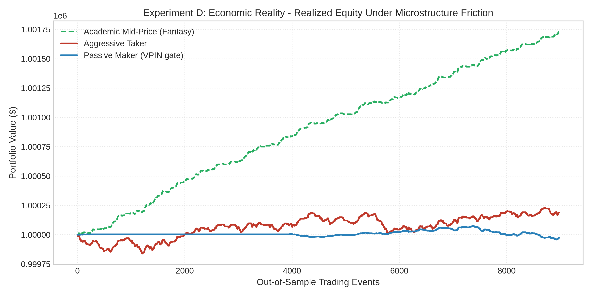

*Equity curves for LightGBM's signals on seed 0 (fantasy +\$1,727, aggressive taker +\$188, passive maker −\$27 on 5 fills). Regenerate with `scripts/plot_exp_d_equity.py`.*

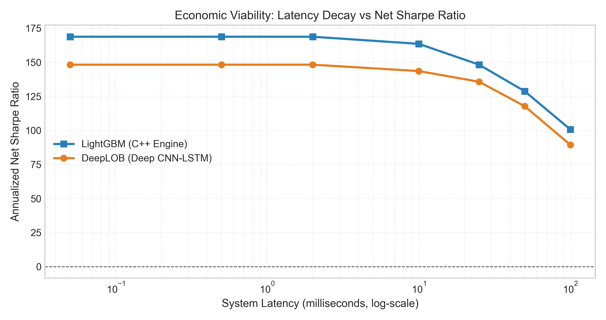

---

## Real-Data Results

All `6` real-world and benchmark datasets are wired, leakage-controlled, and tested end-to-end. Heavy sequence training (`DeepLOB`, `TLOB`, `LSTM`) runs on CUDA GPU ([Colab](#running-on-google-colab)), while NSE 25-stock tabular verification, ML completeness diagnostics, BTC regimes/MM, and LOBSTER run on CPU. Download Kaggle benchmarks with `python scripts/fetch_datasets.py`.

| Dataset | Source | Scale & What the Experiment Does |
|:---|:---|:---|
| **Indian NSE Equities & Derivatives** (`25` instruments + `12` SSFs) | NSE Cash & F&O 5-level `1 s` LOB (`64` full days, Aug–Nov 2026) | `36.0M` snapshots across `5` tick regimes (`0.035–7.41 bp`). Tests Tiers 0–5 + `46f` Flagship Hybrid, `12/12` `SSF→Cash` lead-lag, `22/22` untouched out-of-universe verification, `10`-point ML audit, `K=1..8` ensembles, `N=1..100` averaging, & `LOB-Hybrid 2.0` execution (`src/experiments/nse_*.py`) |
| **Coinbase BTC-USD**, 15-level book, 1 s snapshots, ~12 days (Apr 2021) | [Kaggle, CC0](https://www.kaggle.com/datasets/martinsn/high-frequency-crypto-limit-order-book-data) | Reruns Experiments A–D on 4 contiguous ~3-day segments (`k=20 s`). Labels use a training-only threshold (one third FLAT); VPIN uses real trade flow; Coinbase fees (`0` maker / `4 bp` taker). Follow-ups: `exp_e_tradability`, `exp_f_cross_asset` (`ETH`), `exp_g_regimes`, `exp_h_market_making`, `exp_j_attribution` |
| **FI-2010**, Setup 2 | [Kaggle mirror](https://www.kaggle.com/datasets/ulfricirons/fi-2010) of Ntakaris et al. (2018) | Trains on days 1–7, tests on days 8–10. Isolates the history-vs-architecture crossover vs published DeepLOB (`python -m src.experiments.fi2010_benchmark`) |
| **Optiver Realized Volatility** (Kaggle 2021) | [competition](https://www.kaggle.com/competitions/optiver-realized-volatility-prediction) | Recovers time order with the 1st-place tick-size + t-SNE trick, validates forward in time, and quantifies future-neighbor leakage (`python -m src.experiments.optiver_rvp`) |
| **LOBSTER sample files**: INTC, MSFT, AAPL, AMZN, GOOG, 21 June 2012, 10 levels | [lobsterdata.com](https://lobsterdata.com) (free academic samples) | Resampled onto `100 ms` clock. Decay curves (`100 ms–30 s`), large- vs small-tick regimes, exact-execution market making (`python -m src.experiments.exp_i_lobster`) |
| **Optiver Trading at the Close** (Kaggle 2023) | [competition](https://www.kaggle.com/competitions/optiver-trading-at-the-close) | Auction-imbalance features on winner's split (`400` train / `81` holdout days; `python -m src.experiments.optiver_close`) |

The Optiver data is competition data: accept each competition's rules on kaggle.com once before downloading.

### Indian NSE: 25-Instrument Microstructure, SSF Lead-Lag & Out-of-Universe Verification

Evaluated across `4 × 16`-day chronological walk-forward segments (`11` Train / `2` Val / `3` Test days = `12` full held-out test days, `~268,572` test seconds per instrument = **`6,714,225` total held-out test seconds**). Full tables, error forensics, and confusion matrices live in [`submission/ADDITIONAL_EXPERIMENTS_AND_VERIFICATION.md`](submission/ADDITIONAL_EXPERIMENTS_AND_VERIFICATION.md) and [`NSE_ALPHA_AND_EXECUTION_MASTER_RESEARCH.md`](NSE_ALPHA_AND_EXECUTION_MASTER_RESEARCH.md).

#### 1. Five Relative-Tick Regimes & Out-of-Universe Generalization (`k = 20 s`)

| Relative Tick Regime | Instruments | `±α` Boundary Err % | Baseline `v1` F1 | Upgraded `v2+MH` F1 | Best Deployed (`+SSF`) F1 | Total `ΔF1` | `v1 → Best` ROC-AUC | Mean Batch-100 Win |
|:---|:---:|:---:|:---:|:---:|:---:|:---:|:---:|:---:|
| **1. Tiny Tick (`<0.10 bp`)** | `2` (`NIFTY_FUT`, `BANKNIFTY_FUT`) | `66.9%` | `0.4513` | `0.4824` | **`0.4824`** *(+BNF on NF: `0.4754`)* | `+3.11 pp` | `0.6426 → 0.6741` | **`94.8%`** |
| **2. Small Tick (`0.20–0.65 bp`)** | `9` (e.g. `BHARTIARTL`, `SBIN`, `INFY`, `TCS`, `ONGC`, `TITAN`) | `61.4%` | `0.4305` | `0.4917` | **`0.4963`** | **`+6.58 pp`** | `0.6264 → 0.6900` | **`91.4%`** |
| **3. Medium Tick (`0.65–1.30 bp`)** | `8` (e.g. `RELIANCE`, `HDFCBANK`, `ICICIBANK`, `KOTAKBANK`) | `59.8%` | `0.4297` | `0.4890` | **`0.4957`** | **`+6.60 pp`** | `0.6289 → 0.6899` | **`92.0%`** |
| **4. Large Tick (`1.30–2.50 bp`)** | `4` (`SUZLON`, `ITC`, `BPCL`, `NTPC`) | `63.3%` | `0.4735` | `0.5246` | **`0.5280`** | **`+5.46 pp`** | `0.6629 → 0.7238` | **`91.8%`** |
| **5. Ultra-Large Tick (`>2.50 bp`)** | `2` (`YESBANK`, `IDEA`) | `82.1%` | `0.4989` | `0.5585` | **`0.5608`** | **`+6.18 pp`** | `0.7259 → 0.7790` | **`93.1%`** |

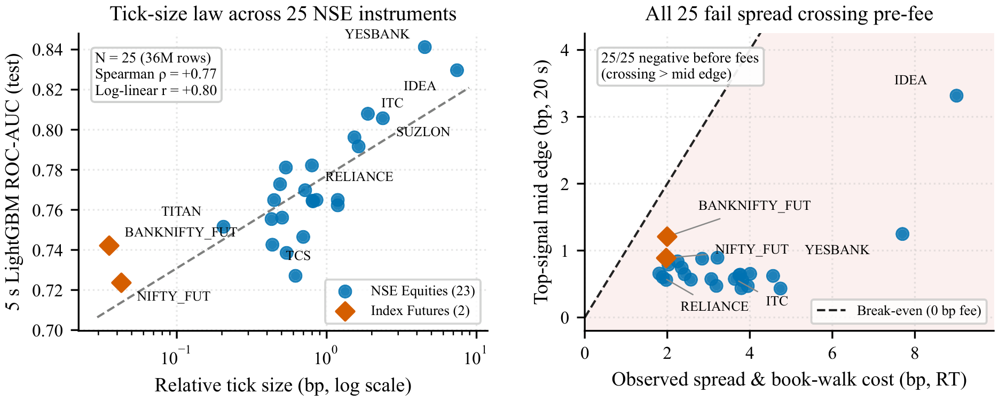

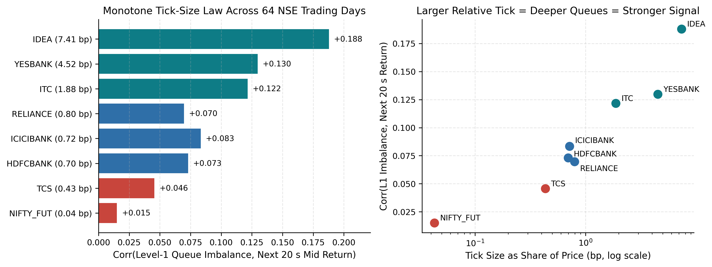

#### 2. Nonparametric Anti-Overfitting Proof (`22` Untouched Instruments + `12` SSF Equities)

| Comparison | Evaluation Cohort | Wins / Total | Mean Before → After | Mean Lift (`Δ`) | Wilcoxon Signed-Rank `p` |
|:---|:---|:---:|:---:|:---:|:---:|
| **Macro-F1: `v2 (38f)` vs `v1 (25f)`** | All `25` Instruments | **`25 / 25` (`100%`)** | `0.4443 → 0.4962` | **`+5.20 pp`** | **`2.98 × 10⁻⁸`** |
| **Macro-F1: `v2+MH(10,20)` vs `v1`** | Strictly Unseen `22` Instruments | **`22 / 22` (`100%`)** | `0.4421 → 0.4999` | **`+5.77 pp`** | **`2.38 × 10⁻⁷`** |
| **ROC-AUC: `v2+MH(10,20)` vs `v1`** | Strictly Unseen `22` Instruments | **`22 / 22` (`100%`)** | `0.6386 → 0.6947` | **`+5.61 pp`** | **`2.38 × 10⁻⁷`** |
| **Macro-F1: Best Deployed vs `v1`** | Strictly Unseen `22` Instruments | **`22 / 22` (`100%`)** | `0.4421 → 0.5044` | **`+6.23 pp`** | **`2.38 × 10⁻⁷`** |
| **Macro-F1: `+SSF` vs `v2+MH`** *(pure SSF)* | All `12` SSF Equities | **`12 / 12` (`100%`)** | `0.5059 → 0.5154` | **`+0.95 pp`** | **`2.44 × 10⁻⁴`** |
| **Macro-F1: `+SSF` vs `v2+MH`** *(pure SSF)* | Strictly Unseen `10` SSF Equities | **`10 / 10` (`100%`)** | `0.5024 → 0.5124` | **`+1.00 pp`** | **`9.77 × 10⁻⁴`** |

- Across **`300 / 300` full held-out trading days** (`25 × 12`), **every single day exceeds `55%` directional hit rate** (minimum day: `58.84%`; cross-stock mean: **`65.49%`**).
- After residualizing common market (`NIFTY_FUT`) and equal-weight sector flow across `64` days × `12` F&O stocks (`48` symbol-segments), companion Single-Stock Futures LOB improves cash `5 s` OOS IC in **`48 / 48` symbol-segments** (`0.1754 → 0.2466`, `2×` stronger than `Cash → SSF`).

#### 3. Complete Model Ladder, Per-Class Health & Calibration (`RELIANCE`, `NIFTY_FUT`, `IDEA`)

| Benchmark | Model | `FLAT` F1 | `UP` F1 | `DOWN` F1 | `Macro-F1 ± Std` | `MCC` | `ROC-AUC` | `LogLoss` | `10-Bin ECE` |
|:---|:---|:---:|:---:|:---:|:---:|:---:|:---:|:---:|:---:|
| **RELIANCE** | `Naïve Momentum` / `LogReg` | `0.482` / `0.252` | `0.383` / `0.482` | `0.401` / `0.461` | `0.422` / `0.398` | `0.134` / `0.143` | — | `1.424` / `1.073` | — |
| **RELIANCE** | `LSTM` / `DeepLOB5` / `TLOB` | `0.388` / `0.333` / `0.416` | `0.404` / `0.461` / `0.457` | `0.418` / `0.446` / `0.460` | `0.403` / `0.413` / `0.444` | `0.106` / `0.146` / `0.175` | — | `1.100` / `1.068` / `1.042` | — |
| **RELIANCE** | `LightGBM v1 (25f)` | `0.4067` | `0.4821` | `0.4737` | `0.4542 ± 0.007` | `0.1910` | `0.6479` | `1.0405` | `0.0087` |
| **RELIANCE** | **`Flagship Hybrid (v2+SSF+MH+TLOB)`** | **`0.5223`** | **`0.5129`** | **`0.5126`** | **`0.5159 ± 0.025`** | **`0.2754`** | **`0.7080`** | **`0.9674`** | **`0.0056`** |
| **NIFTY_FUT** | `LSTM` *(Seg 3 `+10.7%` rally collapse)* | **`0.1794`** ✗ | `0.4585` | `0.3837` | `0.3405 ± 0.076` | `0.0522` | — | `1.1111` | — |
| **NIFTY_FUT** | **`Flagship Hybrid (v2+MH+TLOB)`** | **`0.3844`** | **`0.5123`** | **`0.5269`** | **`0.4745 ± 0.008`** | **`0.2206`** | **`0.6683`** | **`1.0168`** | **`0.0046`** |
| **IDEA** | `LightGBM v1 (25f)` | `0.6679` | `0.4062` | `0.3813` | `0.4851 ± 0.017` | `0.2585` | `0.7231` | `0.9484` | `0.0823` |
| **IDEA** | **`Flagship Hybrid (v2+SSF+MH+TLOB)`** | **`0.7685`** | **`0.4478`** | **`0.4330`** | **`0.5498 ± 0.005`** | **`0.3434`** | **`0.7734`** | **`0.7973`** | `0.0679` |

- Across all `25 × 3 = 75` instrument-class pairs in the deployed models, **minimum per-class F1 is `0.3837`** (zero class collapse), mean class F1s are `0.5090 / 0.5036 / 0.5031`, and near-zero Validation-to-Test gaps (`-0.019` to `+0.009` F1) hold with `ECE = 0.0046–0.0056` on continuous-tick instruments.
- **Why Ensembles & Conviction Filtering Work:** `LightGBM` (`1 s` L1 queue flips) and `TLOB` (`100 s` low-vol attention) disagree `~50%` of the time; `K = 3–4` orthogonal subsets (`Tree + Transformer + CNN + Drift`) beat `K = 7–8` over-ensembles. Filtering for top confidence (`max prob ≥ 0.60–0.65`) lifts `RELIANCE` accuracy to **`80.7%–89.4%`**.

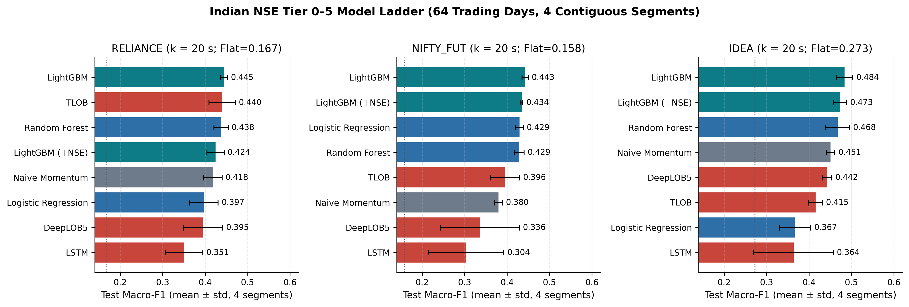

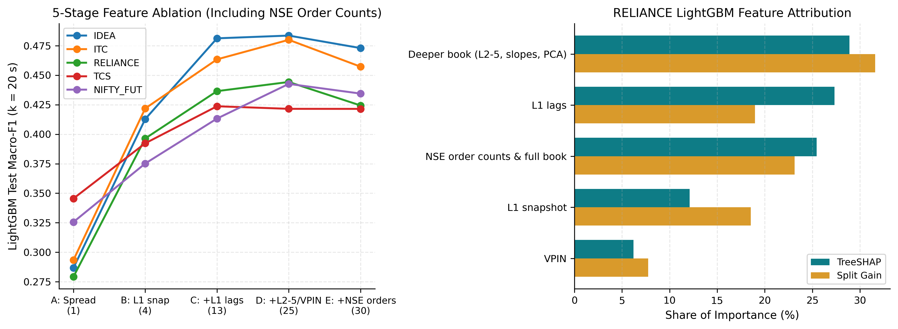

#### 4. Execution Cost Impossibility vs. `LOB-Hybrid 2.0 (+SSF)` Execution Alpha

- **Standalone taker & unfiltered MM fail statutory hurdles:** Even at top `2%` confidence (`20 s`), standalone taker trades lose gross before `3.5–5.6 bps` statutory fees across **all `25` NSE instruments** (`-0.968 bps` on `BANKNIFTY_FUT` and `-1.177 bps` on `NIFTY_FUT` even at `72.9%` directional hit, down to `-6.662 bps` on `YESBANK`).
- **Execution timing wins every day:** Using the `46f` Flagship/`LOB-Hybrid 2.0 (+SSF)` signal as a passive-opportunistic execution overlay on already-intended 15-minute parent orders beats `TWAP` on **`12/12` OOS days and `4/4` segments** (**`+0.312` to `+0.445 bps` equities; `+0.671 bps` `NIFTY_FUT`**), a **`+39%` cost-saving lift** over cash-only `v1` (`LOB-Hybrid 2.0`).

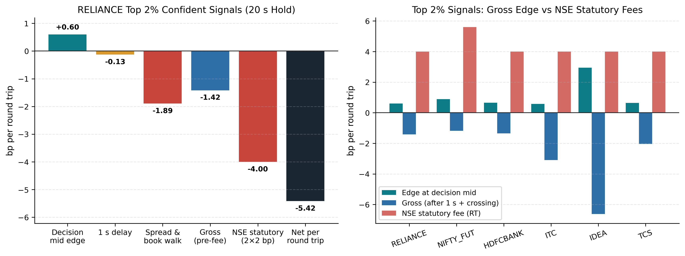

### Coinbase BTC-USD: Experiments A–D

These use 4 contiguous segments of about 3 days each. Each segment is split 70/15/15 in time, and the tables give the mean ± std across segments. Horizons count 1-second snapshots, so k = 20 means 20 seconds ahead. The training split sets the label threshold so that a third of training rows are FLAT, which puts random guessing at about 0.333 macro-F1.

**Model hierarchy (k = 20)**

| Tier | Model | Accuracy | Macro-F1 |
|:---:|:---|:---:|:---:|
| 0 | Naïve Flat | 0.295 | 0.152 |
| 0 | Naïve Momentum (lag k) | 0.415 | 0.413 ± 0.021 |
| 1 | Logistic Regression | 0.463 | 0.448 ± 0.016 |
| 2 | Random Forest | 0.474 | 0.465 ± 0.017 |
| 3 | **LightGBM** | 0.476 | **0.467 ± 0.021** |
| 4 | LSTM | 0.448 | 0.397 ± 0.044 |
| 5 | DeepLOB | 0.429 | 0.401 ± 0.048 |
| 5 | TLOB | 0.455 | 0.449 ± 0.025 |

LightGBM beats DeepLOB on 4/4 segments (+0.067 on average), TLOB on 4/4 (+0.018) and logistic regression on 4/4 (+0.020). Its edge over Random Forest (+0.002, 3/4 segments) is noise. The learned models add about 0.05 macro-F1 over naive momentum, so the signal is real but small.

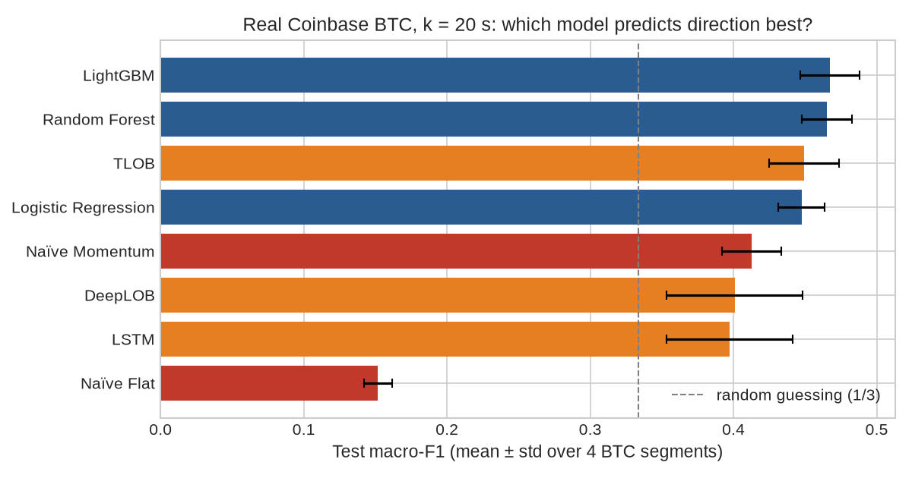

**Signal decay (LightGBM)**

| Horizon | Macro-F1 | Naïve Momentum |
|:---:|:---:|:---:|
| 10 s | 0.540 ± 0.020 | 0.463 |
| 20 s | 0.467 ± 0.021 | 0.413 |
| 50 s | 0.395 ± 0.015 | 0.367 |
| 100 s | 0.350 ± 0.012 | 0.358 |

Skill is highest at the shortest horizon and is gone by 100 s, where LightGBM no longer beats momentum.

**Feature ablation (LightGBM, k = 20)**

| Feature set | # Features | Macro-F1 |
|:---|:---:|:---:|
| A: Spread only | 1 | 0.237 ± 0.017 |
| B: L1 snapshot | 4 | 0.436 ± 0.016 |
| C: B + lags of L1 signals | 13 | 0.460 ± 0.019 |
| D: C + levels 2–3 | 16 | 0.464 ± 0.018 |
| E: All features | 27 | 0.467 ± 0.021 |

The top of the book carries most of the signal. Lags add +0.024, and everything past level 1 adds less than +0.01. By split gain, the leading features are `slope_ask` 15.1%, `slope_bid` 14.0%, `imbalance_l10` 9.9%, `vpin` 9.7%, `ofi_lag_1` 5.6% and `spread_ticks` 4.8%. The book-shape features score high on gain even though the ablation says they add little. Gain splits credit arbitrarily between correlated features, so it is not a causal attribution.

**Execution** (test-set signals, 0.1 BTC lots, ±0.5 BTC cap, 4 bp taker fee, 0 bp maker fee, 1 s latency)

| Model | Regime | Net PnL (\$) | Trades | Fees (\$) |
|:---|:---|:---:|:---:|:---:|
| LightGBM | Academic mid-price (fantasy) | 8,055 ± 988 | 15,595 | 0 |
| LightGBM | Aggressive taker | −36,394 ± 7,271 | 15,595 | 37,631 |
| LightGBM | Passive maker (VPIN gate) | −478 ± 776 | 755 | 0 |
| DeepLOB | Academic mid-price (fantasy) | 5,486 ± 961 | 13,337 | 0 |
| DeepLOB | Aggressive taker | −31,071 ± 10,144 | 13,337 | 31,809 |
| DeepLOB | Passive maker (VPIN gate) | −1,411 ± 253 | 896 | 0 |

- Fees alone are about 4.7× the fantasy profit. Both models lose about \$2.3 per taker trade. DeepLOB loses less in total only because it trades less.
- Passive orders only fill when the price trades through them, which by construction is when the market moves against the order. Under this rule, so few orders fill that the strategy loses a little.
- **Latency barely matters here.** Raising the latency from 0 to 30 s moves LightGBM from −\$34.5k to −\$41.0k and DeepLOB from −\$30.0k to −\$34.8k, which is small next to the fees. Median single-sample inference takes 0.14 ms for LightGBM (CPU) and 5.7 ms for DeepLOB (CUDA). Both are far below the 1 s snapshot interval.

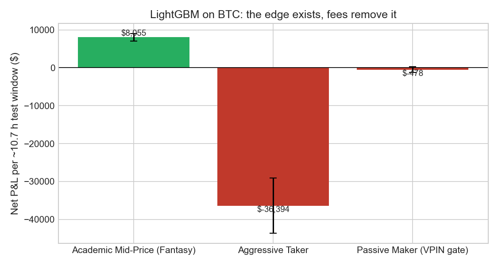

### BTC: can a filtered signal pay? (Experiment E)

Each signal is traded as a round trip. The model enters with a taker order at the next snapshot and exits with a taker order k seconds later, walking the book both times. It trades only the most confident share of rows ("coverage", with the threshold set on validation data). *Direction* labels are the labels used above. *Cost-aware* labels mark UP only if buying at the ask and selling at the bid k seconds later would beat a 4 bp fee per side (DOWN is symmetric). Gross is in bp per round trip after the spread and book walking, before fees.

| Labels | Hold | Coverage | Trades / segment | Mid move (bp) | Gross (bp) |
|:---|:---:|:---:|:---:|:---:|:---:|
| Direction | 20 s | 100% | 1,667 | 0.92 | −0.03 |
| Direction | 20 s | 5% | 701 | 2.21 | 0.55 |
| Direction | 20 s | 1% | 250 | 2.42 | 0.58 |
| Cost-aware | 60 s | 2% | 168 | 1.92 | **0.70** |
| Cost-aware | 300 s | 100% | 123 | −0.52 | −1.19 |

Confident signals do catch bigger moves (about 2 bp of mid move against 1 bp), but execution eats most of them. The best gross edge is 0.70 bp, against 8 bp needed to break even at 4 bp per side. At 1 bp per side the best setting still nets −1.3 bp. Full grid: [tradability_summary.csv](artifacts/btc/tradability/tradability_summary.csv).

**Where the edge goes.** [decompose_btc_edge.py](scripts/decompose_btc_edge.py) splits each round trip (direction labels, 20 s hold) into the edge at the decision mid, the cost of entering one snapshot (1 s) later, and the cost of crossing the spread and walking the book ([csv](artifacts/btc/tradability/edge_decomposition.csv)):

| Coverage | Edge at decision mid | 1 s delay | Crossing | Gross | Hit rate | Break-even hit rate at 0 / 1 / 4 bp fee |
|:---:|:---:|:---:|:---:|:---:|:---:|:---:|
| 100% | 1.01 bp | −0.27 | −0.73 | 0.01 | 60.7% | 63% / 90% / over 100% |
| 10% | 1.97 bp | −0.65 | −0.89 | 0.43 | 68.9% | 68% / 92% / over 100% |
| 2% | 2.23 bp | −0.75 | −1.01 | 0.47 | 71.8% | 70% / 94% / over 100% |

The quoted spread is only part of the crossing cost (about 0.2 bp per round trip on average); the rest is walking the book for 0.1 BTC. The most confident signals lose almost three times as much to the one-second delay as the average signal, because they predict the moves that come soonest. And the average absolute 20 s move on these rows is about 4.3 bp, so even a perfect direction forecast could not cover the 8 bp taker round trip. Break-even hit rate is 1/2 + cost / (2 × average absolute move); the [final report](submission/PROJECT_REPORT.md#52-where-exactly-does-the-edge-go) explains it.

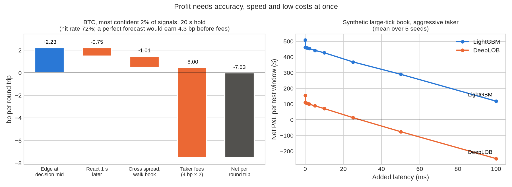

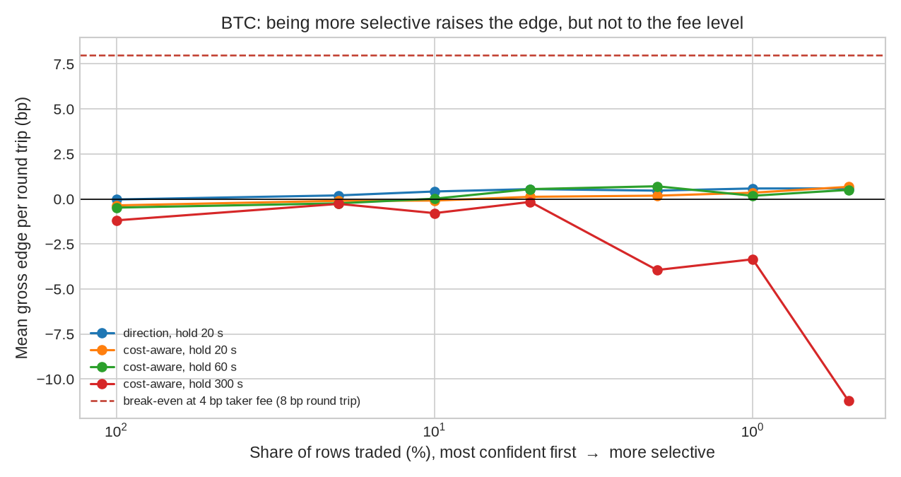

### BTC: does Ethereum's book help? (Experiment F)

The same LightGBM is trained on identical splits, with and without ETH-USD book features. The ETH features use the latest ETH snapshot at or before each BTC timestamp.

| Horizon | BTC only | + ETH | Δ macro-F1 | Segments improved | ETH share of gain |
|:---:|:---:|:---:|:---:|:---:|:---:|
| 10 s | 0.540 | 0.556 | +0.016 ± 0.007 | 4/4 | 26.5% |
| 20 s | 0.467 | 0.480 | +0.012 ± 0.005 | 4/4 | 31.0% |
| 50 s | 0.395 | 0.402 | +0.007 ± 0.008 | 4/4 | 33.6% |

The gain is small but consistent, and it fades with horizon. That pattern fits ETH leading BTC by a few seconds.

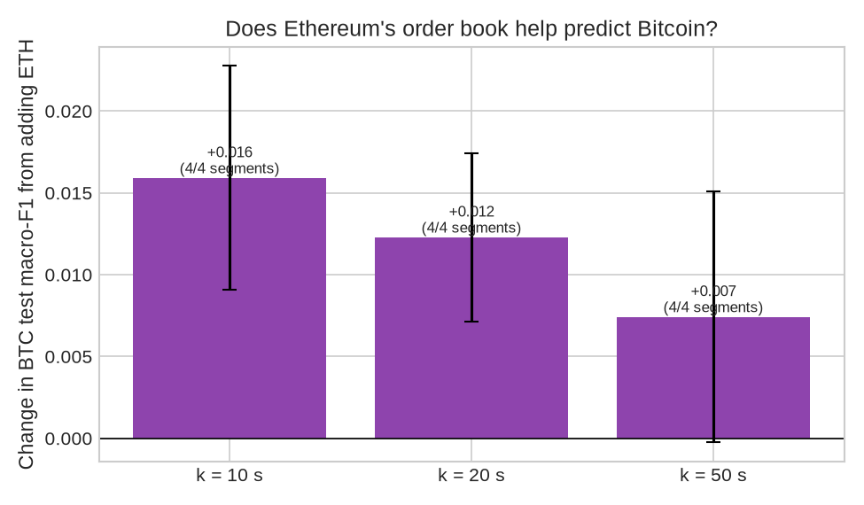

### BTC: does the edge survive in any regime? (Experiment G)

Spec section 8 asks for market regimes where the edge survives costs, for example periods of toxic order flow. This experiment splits Experiment E's trades by terciles of three variables known at decision time: VPIN, the quoted spread, and realized volatility over the previous 60 s. Cut-offs come from each segment's training rows. Each cell is a strategy that trades only inside that regime. Gross is bp per round trip after the spread, before fees; the 95% CI is a moving-block bootstrap over the pooled trades of all 4 segments ([full table](artifacts/btc/regimes/regime_tradability.csv)).

| Signal (coverage) | Regime | Trades | Gross (bp) | 95% CI | Segments gross > 0 |
|:---|:---|:---:|:---:|:---:|:---:|
| Direction, all signals | low volatility | 1,980 | +0.46 | 0.28 to 0.65 | 4/4 |
| Direction, all signals | high volatility | 3,065 | −0.45 | −0.68 to −0.23 | 0/4 |
| Direction, top 2% | low volatility | 413 | +1.08 | 0.73 to 1.47 | 4/4 |
| Direction, top 2% | high VPIN | 676 | +0.50 | −0.02 to 1.02 | 3/4 |
| Cost-aware, top 2% | high VPIN | 336 | **+1.43** | 0.24 to 2.84 | 3/4 |
| Cost-aware, top 2% | low volatility | 193 | +1.32 | 0.49 to 2.54 | 3/4 |

- **No regime survives costs.** The best cell earns +1.43 bp gross. At 1 bp fee per side (2 bp per round trip) it still nets −0.57 bp, and at the 4 bp taker fee a round trip needs 8 bp.
- **The edge is most consistent in calm markets.** Low volatility is positive before fees at every coverage, on all 4 segments, for the direction model. It is also where predictability is highest (macro-F1 0.483 vs 0.443 in high volatility).
- **Toxic flow does not help.** Macro-F1 is the same in every VPIN tercile (0.467–0.468), and high VPIN is the best cell for only one of the two models. The spec's idea that toxicity regimes are where the edge survives is not supported here.
- The table covers 54 cells, so a few confidence intervals will exclude zero by chance. The low-volatility result holds across coverages, segments and both models.

### BTC: market making with an adverse-selection model (Experiment H)

Spec section 6.2 proposes earning the spread with resting quotes, and modelling the adverse selection those quotes suffer. For every snapshot, the experiment labels a hypothetical 0.1 BTC quote at the touch on each side (resting up to 30 s) with whether it fills and its markout: the mid price 30 s after the fill relative to the fill price. LightGBM learns the value of posting from the microstructure features plus new order-flow features (limit, market and cancel notional per level). Three strategies then quote both sides with a ±0.5 BTC inventory limit:
- **always:** quote both sides all the time;
- **rule:** the spec's Scenario A/B: quote when the spread is at least its training median and VPIN is below its training 67th percentile, and cancel when VPIN exceeds its 90th percentile;
- **model:** quote a side only when the predicted value of posting clears a threshold chosen on validation data.

One-second snapshots cannot show queue position, so each strategy runs under three fill rules that bracket the truth. *Pessimistic* fills only when the price trades through the quote. *Queue* fills once recorded market flow at the quote's price exceeds the resting size ahead of it. *Optimistic* assumes the front of the queue. Net P&L per test window (about 10.7 h), mean ± std over 4 segments, 0 bp maker fee, leftover inventory closed at the 4 bp taker fee ([csv](artifacts/btc/market_making/mm_summary.csv)):

| Strategy | Pessimistic | Queue | Optimistic | Segments > 0 |
|:---|:---:|:---:|:---:|:---:|
| always | −\$4,677 ± 57 | −\$4,638 ± 68 | −\$4,509 ± 115 | 0/4 under every rule |
| rule (spec Scenario A/B) | −\$1,562 ± 1,033 | −\$1,562 ± 1,019 | −\$1,445 ± 1,103 | 0/4 |
| model | −\$670 ± 778 | −\$501 ± 818 | +\$81 ± 718 | 0, 1 and 2 of 4 |

- **Naive quoting loses about \$10,400 per day.** The average fill loses 1.7–1.9 bp 30 s later under the pessimistic and queue rules, and 0.6–0.8 bp even at the front of the queue.
- **The spec's rule cuts losses by about two thirds; the model by 86% or more,** but the model only breaks even under the optimistic rule, and that result is indistinguishable from zero.
- **Adverse selection is only weakly predictable.** Given a fill, a LightGBM classifier tells toxic fills (negative markout) from good ones with an AUC of 0.55–0.58.
- **VPIN does not sort fills.** Markouts by VPIN tercile show no consistent pattern; low-VPIN bid fills are the worst (−2.25 bp under the pessimistic rule).
- **Why it fails:** BTC trades in \$0.01 steps at about \$60,000, so the spread is 0.0017 bp and sits at one tick 80% of the time. A typical one-second move is 0.5 bp. There is no spread to earn, only adverse selection to absorb. This is spec section 1's small-tick case, measured.
- The Coinbase per-level market-order columns add up to only about 30–40% of the traded volume, so the queue rule here behaves almost like the pessimistic one. The fill rules are bounds, not estimates.

### LOBSTER: Nasdaq event data, large- vs small-tick stocks (Experiment I)

LOBSTER's free sample files contain every order event for five Nasdaq stocks on 21 June 2012 (10 levels, 9:30–16:00). The experiment resamples them onto a 100 ms clock, which makes the spec's horizons (100 ms to 30 s) possible on real data. The stocks fall cleanly into the two regimes of spec section 1:

| | Tick as share of price | Spread at one tick | Median shares at best level | Mid-price changes per minute |
|:---|:---:|:---:|:---:|:---:|
| INTC, MSFT (large tick) | 3.3–3.7 bp | 77% of the time | ~13,000 | 8–10 |
| AAPL, AMZN, GOOG (small tick) | 0.17–0.45 bp | under 1% | ~100 | 60–165 |

**Decay curve.** Best learned model (logistic regression, LightGBM, or LightGBM with order-flow features) minus naive momentum, macro-F1 on the test period ([full table](artifacts/lobster/lobster_prediction.csv)):

| Stock | 100 ms | 500 ms | 1 s | 5 s | 10 s | 30 s |
|:---|:---:|:---:|:---:|:---:|:---:|:---:|
| INTC (large) | −0.004 | +0.019 | +0.050 | **+0.113** | +0.098 | −0.025 |
| MSFT (large) | −0.005 | +0.036 | **+0.071** | +0.042 | +0.008 | +0.008 |
| AAPL (small) | −0.020 | +0.022 | +0.019 | +0.003 | +0.027 | +0.059 |
| AMZN (small) | −0.066 | −0.047 | −0.008 | −0.042 | −0.029 | −0.022 |
| GOOG (small) | −0.085 | −0.040 | −0.027 | −0.035 | −0.036 | +0.009 |

- **Large-tick stocks are more predictable**, as the spec expects. On INTC and MSFT the learned models beat momentum from 500 ms to 10 s, peaking at 1–5 s (INTC at 5 s: 0.457 vs 0.344).
- **Nothing is predictable at 100 ms on large-tick stocks** because the mid price almost never moves: 99% of INTC's and MSFT's 100 ms test labels are FLAT. The spec expected the peak in the sub-second range; on this data it comes later.
- **On small-tick stocks the learned models mostly lose to naive momentum** (AMZN and GOOG at almost every horizon). Their books change so fast that the last move is a strong baseline.
- **Order-flow features help only small-tick stocks:** adding limit, market and cancel flows to LightGBM gains +0.011 macro-F1 on average for AAPL, AMZN and GOOG, and −0.003 for INTC and MSFT.

**Market making.** Experiment H's setup with 100-share lots, a ±500-share inventory limit, quotes resting up to 30 s, and Nasdaq-style 2012 pricing (assumed 0.30 cents per share to take liquidity, a 0.20 cent rebate to provide it). LOBSTER records every execution with its price, so the queue rule is exact except for cancellations ahead in the queue. Mean markout per fill 30 s later, in bp after the rebate ([csv](artifacts/lobster/lobster_adverse_selection.csv)):

| Stock | Pessimistic | Queue | Optimistic (front of queue) |
|:---|:---:|:---:|:---:|
| INTC (large) | −2.22 | −2.15 | +1.24 |
| MSFT (large) | −1.78 | −1.78 | +0.70 |
| AAPL (small) | +0.14 | +0.17 | +0.21 |
| AMZN (small) | +0.52 | +0.55 | +0.67 |
| GOOG (small) | −0.13 | −0.03 | +0.03 |

- **On large-tick stocks, queue position decides everything.** A fill at the front of the queue earns +0.7 to +1.2 bp (about 0.7 bp of that is the rebate on INTC); a fill at the back loses about 2 bp. With ~13,000 shares queued at the best price, a newly posted order is nearly always at the back, so the queue rule matches the pessimistic one. This is why high-frequency firms compete for queue priority.
- **On small-tick stocks the touch is often wide** (13–30 ticks on average), so joining it can earn a little: AMZN and AAPL fills are slightly positive under every rule.
- **Adverse selection is not predictable here** (AUC 0.39–0.53), and the dollar P&L comes from a single test window of about one hour dominated by inventory moves, so it is illustrative only ([csv](artifacts/lobster/lobster_market_making.csv)).
- One day per stock, and the test period is the last hour of the session, which trades differently from the rest of the day. Treat all LOBSTER numbers as a single-day case study.

### BTC: attribution and significance (Experiment J)

Spec sections 5.1 and 5.3 ask whether improvements over the baselines are statistically significant, and for SHAP-style attribution. Experiment J retrains Experiment A's tabular models on each BTC segment (k = 20 s) with the same settings and keeps their per-row test predictions. DeepLOB is retrained the same way on a GPU (Colab, `--deeplob`).

**Significance** of LightGBM's macro-F1 advantage, pooled over the 4 segments. The CI is a moving-block bootstrap (5-minute blocks, segments resampled separately); McNemar's test compares which rows each model gets right ([csv](artifacts/btc/attribution/significance_vs_lightgbm.csv)):

| LightGBM vs | Macro-F1 difference | 95% CI | Segments LightGBM better | McNemar p |
|:---|:---:|:---:|:---:|:---:|
| Naive momentum | +0.059 | 0.050 to 0.068 | 4/4 | < 0.0001 |
| Logistic regression | +0.019 | 0.015 to 0.024 | 4/4 | < 0.0001 |
| Random Forest | +0.004 | 0.001 to 0.007 | 3/4 | 0.015 |
| DeepLOB | +0.058 | 0.049 to 0.068 | 4/4 | < 0.0001 |

LightGBM is significantly better than all four, but its edge over Random Forest is tiny. DeepLOB, trained on the raw book, is about as far behind LightGBM as naive momentum is. (Retrained here, DeepLOB trails by +0.058; Experiment A's run gave +0.067.)

**TreeSHAP** (exact, from LightGBM's `pred_contrib`, on 20,000 test rows per segment), share of mean |SHAP| by feature group, next to Experiment C's gain shares ([groups](artifacts/btc/attribution/shap_lightgbm_groups.csv), [features](artifacts/btc/attribution/shap_lightgbm_features.csv)):

| Feature group | SHAP share | Gain share |
|:---|:---:|:---:|
| Deeper book (slopes, L5/L10 imbalance, OFI PCA) | 39.3% | 47.1% |
| L1 lags (OFI, imbalance, micro-price) | 34.6% | 25.2% |
| L1 snapshot | 14.1% | 13.6% |
| VPIN | 6.6% | 9.7% |
| Levels 2–3 | 5.4% | 4.5% |

- SHAP gives the recent history of level-1 signals much more weight than gain importance did (35% vs 25%), which fits the ablation (lags were the biggest single addition). The book-shape features still lead, led by `slope_ask` (12.3%) and `slope_bid` (11.8%).
- **Confusion matrices** ([csv](artifacts/btc/attribution/confusion_matrices.csv)): FLAT is the hardest class for every model. LightGBM recalls 40% of FLAT, 50% of UP and 52% of DOWN rows; naive momentum 39%, 44% and 42%. The tabular models spread their errors fairly evenly across the other two classes. DeepLOB does not: it recalls only 30% of FLAT rows and calls 41% of them DOWN, and it recalls DOWN (54%) much better than UP (42%), so part of its score comes from leaning toward one direction.

**DeepLOB attribution** (gradient × input for the predicted class, on 2,000 test windows of 100 snapshots per segment; shares of the total, mean over 4 segments; [csv](artifacts/btc/attribution/deeplob_attribution.csv)):

| What the network looks at | Share |
|:---|:---:|
| Order sizes (vs prices; partly a scaling effect, see below) | 84% (69–93% by segment) |
| Level 1 | 18% |
| Each of levels 2–10 | about 9% |
| The most recent 10 of the 100 snapshots | 57% (40–79%) |
| Ask side (vs bid) | 52% |

- **Like LightGBM, DeepLOB relies on queue sizes and on recent history.** Level 1 counts twice as much as any other level, and more than half the weight falls on the last 10 seconds of a 100-second window. That matches the ablation (level-1 signals and their short lags carry most of LightGBM's skill) and the decay curve (skill fades within tens of seconds).
- **Deeper levels get almost equal weight each**, so the network uses the overall depth profile rather than any particular level. LightGBM gets the same information more compactly from the book-slope and deep-imbalance features (39% of its SHAP).
- **The sizes-vs-prices split is partly built in.** Gradient × input grows with the size of the input. Prices enter as their relative distance from a fixed reference price (a few percent), while sizes enter log-scaled around 1, so prices are bound to score lower. Compare levels and time steps with each other; don't read the 84% as a causal effect. The level and recency patterns compare like with like, so they are the robust findings.

### Micro-price as a target (Experiment K)

Spec section 3.3 calls the gap between the mid price and the micro-price "an additional, highly effective target variable". The micro-price here is the imbalance-weighted mid, so the gap is micro − mid = I × spread / 2, with I the level-1 queue imbalance. Experiment K asks three questions on BTC (4 segments) and LOBSTER (5 stocks), from 500 ms to 50 s ahead ([summary](artifacts/microprice/microprice_summary.csv), [betas](artifacts/microprice/microprice_beta_summary.csv)):

**1. Does the mid price move toward the micro-price?** β is the slope of the future mid change on today's gap, fitted on training rows: β = 1 means the gap has fully closed.

| Horizon | Large-tick β (INTC, MSFT) | Small-tick β (AAPL, AMZN, GOOG) | BTC β |
|:---:|:---:|:---:|:---:|
| 500 ms | 0.12 | 0.01 | — |
| 1 s | 0.22 | 0.02 | — |
| 5 s | 0.68 | 0.03 | — |
| 10 s | 0.93 | 0.03 | 0.38 |
| 30 s | 1.32 | 0.00 | — |
| 50 s | — | — | 0.69 |

On large-tick stocks the gap closes fully within about 10 s, and by 30 s the mid moves *further* than the gap (β > 1), a sign that the simple weighted mid understates where the price is going. Stoikov's full micro-price corrects for this. On small-tick stocks the gap barely closes. On BTC it closes partly, but at 0.06 bp it is tiny next to 2–6 bp moves.

**2–3. Is the micro-price a better target?** Information coefficient (IC, correlation of the forecast with the realized future *mid* change) on the test period:

| | Large-tick 5 s | Large-tick 10 s | Small-tick 1 s | BTC 10 s |
|:---|:---:|:---:|:---:|:---:|
| Micro-price rule (β × gap, one parameter) | **0.290** | **0.278** | 0.062 | 0.024 |
| Momentum (past k-step return) | 0.037 | 0.012 | 0.042 | 0.074 |
| LightGBM trained on future mid change | 0.209 | 0.170 | **0.155** | **0.263** |
| LightGBM trained on future micro-price change | 0.080 | 0.009 | −0.007 | 0.260 |
| Control (LightGBM on shuffled targets) | −0.003 | 0.005 | −0.003 | 0.002 |

- **As a predictor, the gap is excellent where the tick is large.** On INTC and MSFT the one-parameter rule matches or beats LightGBM with about 40 features from 5 s on, and gets the direction of the mid's next move right 64–82% of the time (82% at 500 ms, falling to 64% at 30 s). LightGBM falls behind it at longer horizons, possibly because the morning training session differs from the last-hour test period.
- **As a training target, it is worse than the mid itself.** Trained on future micro-price changes and judged on future mid changes, LightGBM was never significantly better than the model trained on the mid directly: significantly worse in 21 of 37 cases (all large-tick cases, 11 of 15 small-tick cases; block-bootstrap 95% CIs) and indistinguishable on BTC, where the micro-price and the mid are almost the same.
- **Easier to predict is not the same as useful.** On small-tick stocks, up to 10 s ahead, the micro-price's own future change is much more predictable than the mid's (R² 0.06–0.08 vs 0.00–0.02), because it moves with queue sizes that revert. That predictability does not carry over to the price.
- **The control behaves.** LightGBM trained on shuffled targets (training and validation, 3 shuffles) scores IC −0.0005 averaged over all 37 cases. `python scripts/check_microprice_results.py` runs this and 18 other automatic checks on the results.

### FI-2010 Setup 2

The models train on days 1–7 and are tested on days 8–10. Accuracy (%), mean ± std over 3 training seeds:

| k | Naïve Flat | Logistic | LightGBM | Logistic + history | LightGBM + history | DeepLOB (ours) | DeepLOB (published) |
|:---:|:---:|:---:|:---:|:---:|:---:|:---:|:---:|
| 10 | 70.7 | 70.8 | 53.2 | **86.1** | 78.0 ± 0.6 | 83.1 ± 0.3 | 84.5 |
| 20 | 62.1 | 64.1 | 47.2 | **78.3** | 56.6 ± 0.0 | 74.1 ± 0.5 | 74.8 |
| 50 | 47.3 | 43.9 | 44.1 | 66.5 | 64.4 ± 0.0 | **78.2 ± 0.2** | 80.5 |
| 100 | 34.4 | 40.0 | 42.8 | 60.2 | 75.7 ± 0.1 | **77.5 ± 0.4** | — |

*History* adds lagged changes of the 40 raw book columns to the 144 handcrafted features. Logistic regression has no spread because its solver is deterministic and the test days are fixed. The seeds only vary DeepLOB's and LightGBM's training, and that variation is small (at most 0.6 points).

- **Short horizons: simple features with history beat DeepLOB.** At k = 10, logistic regression with history scores 86.1% against 83.1 ± 0.3% for our DeepLOB (and 84.5% published). At k = 20 it is 78.3% against 74.1 ± 0.5%. The gap is several times the seed-to-seed spread, so it is not a lucky seed. DeepLOB's short-horizon advantage over snapshot features comes mostly from seeing a window of past books, not from its architecture.
- **Long horizons: DeepLOB wins clearly.** At k = 50 it leads by 12 points, and at k = 100 by 1.8 points over LightGBM with history.
- **Our DeepLOB reproduces the paper** to within 0.7–2.3 points.

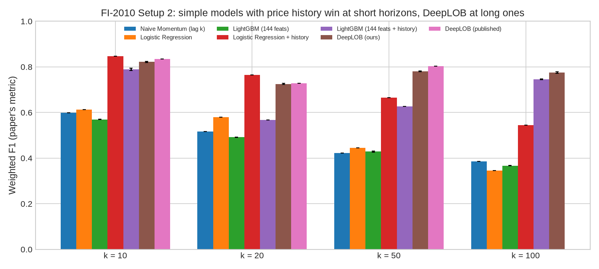

**Why LightGBM + history fails at k = 20 (and underperforms at k = 10).** [diagnose_fi2010_lightgbm.py](scripts/diagnose_fi2010_lightgbm.py) retrained it with early stopping and at fixed numbers of boosting rounds ([csv](artifacts/fi2010/diagnose_lightgbm_history.csv)):

| k | Rounds | Validation acc. | Test acc. | Predicted FLAT share on test | Actual FLAT share on test |
|:---:|:---:|:---:|:---:|:---:|:---:|
| 10 | 10 | 85.9% | 87.7% | 82% | 71% |
| 10 | 356 (early stopping) | 86.0% | 77.4% | 62% | 71% |
| 20 | 10 | 87.2% | 54.5% | 29% | 62% |
| 20 | 446 (early stopping) | 87.6% | 56.7% | 28% | 62% |

- **It is not an early-stopping bug.** At k = 20 the test accuracy is 54–57% at every number of rounds.
- **Validation accuracy does not predict test accuracy.** It sits at 86–88% for every setting, while test accuracy ranges from 55% to 88%. The validation days cannot tell good models from bad ones here.
- **The test days are calmer than the training days.** FLAT makes up 60% (k = 10) and 49% (k = 20) of training labels, but 71% and 62% of test labels. LightGBM learns to call moves from the size of recent book changes on the training days, and on the calmer test days it predicts far too few FLATs (28% against 62% at k = 20). Logistic regression is linear and degrades much less under this shift.
- **The 87.7% at 10 rounds is not a valid result.** It was found by looking at test accuracy, which is exactly what a benchmark must not do. It does show that LightGBM *can* use these features well. A volatility-normalized version of the history features is the natural next test.

### Optiver Realized Volatility

The time order is recovered with the 1st-place trick, and the models are validated on 4 forward-in-time folds. RMSPE (lower is better):

| Model | RMSPE |
|:---|:---:|
| Naïve (current realized volatility) | 0.337 ± 0.017 |
| LightGBM (book/trade features) | 0.235 ± 0.012 |
| + nearest-neighbour features, past-only | 0.223 ± 0.014 |
| + nearest-neighbour features, 1st-place style (uses future windows) | 0.214 ± 0.014 |
| LightGBM, shuffled K-fold CV | 0.214 ± 0.009 |

Restricting neighbours to the past keeps about 59% of the nearest-neighbour gain (0.0125 of 0.0212). Shuffled K-fold CV makes the plain model look as good as the leaky one. Volatility is far more predictable than direction: the model cuts the naïve error by about 30%. Early stopping uses a held-out slice of the training ids, never the scored fold. The earlier run that stopped on the scored fold is kept for reference in [rvp_summary_v1_early_stop_on_scored_fold.csv](artifacts/optiver_rvp/rvp_summary_v1_early_stop_on_scored_fold.csv).

### Optiver Trading at the Close

This uses the winner's split: train on the first 400 days, hold out the last 81. MAE on the holdout:

| Model | MAE |
|:---|:---:|
| Zero prediction | 5.994 |
| LightGBM, trained once | 5.856 |
| LightGBM, trained once + demean | 5.853 |
| LightGBM, retrained every 12 days + demean | **5.848** |

The model improves on predicting zero by about 2.4%. Retraining helps only marginally. The top features are `market_urgency` (11.8% of gain), `seconds_in_bucket`, `liquidity_imbalance` and the reference-price/WAP imbalances.

---

## C++20 Latency Benchmark

[main_benchmark.cpp](cpp/src/main_benchmark.cpp) times feature extraction plus tree-ensemble inference plus a simulated order on 100,000 snapshots from a random-walk book.

**Scope.** The ensemble is **randomly generated** (50 trees × 3 classes, depth 6, 10 real features plus 6 zero inputs). It is not the trained LightGBM model, and C++ features are not checked against the Python pipeline. The numbers measure the cost of evaluating a tree ensemble of that size. They are not the latency of the model evaluated above, and they do not include network or market-data parsing ("wire-to-order").

Latest run ([artifacts/cpp_latency_benchmarks.csv](artifacts/cpp_latency_benchmarks.csv), GCC 15.2, `-O3 -march=native`):

| Stage | P50 | P99 |
|:---|:---:|:---:|
| Feature extraction | below timer resolution | 0.2 µs |
| Tree inference | 1.8 µs | 6.1 µs |
| End-to-end loop | 1.9 µs | 6.3 µs (P99.9 15.1 µs) |

Throughput: about 399k snapshots/s, including timing overhead.

**Trained model in C++.** [benchmark_trained_model.py](scripts/benchmark_trained_model.py) exports the LightGBM model trained on BTC segment 0 (k = 20) and generates C++ code for it. [trained_model_benchmark.cpp](cpp/src/trained_model_benchmark.cpp) then checks the C++ output against LightGBM on 20,000 test rows. The model has 109 boosting rounds × 3 classes (327 trees, 20,601 leaves) on 27 features. The C++ scores match LightGBM exactly (max abs diff 0, 100% argmax agreement). Single-row latency is 10.5 µs at P50 and 17.9 µs at P99 ([csv](artifacts/cpp_trained_model_benchmark.csv)). This run was taken while other jobs were using the CPU, so treat the timings as an upper bound. [optimization_comparison.cpp](cpp/src/optimization_comparison.cpp) compares AoS vs SoA layouts and branchless tree evaluation on the same kind of synthetic ensemble.

---

## Repository Structure

```
ML_Project_2026/
├── README.md
├── LICENSE                                  # All Rights Reserved (no unauthorized publication/redistribution)
├── Dockerfile                               # Container image for LOB Alpha Studio (port 7860)
├── requirements-app.txt                     # Lightweight CPU dependencies for the live web app
├── run_dashboard.bat                        # One-click Windows launcher for LOB Alpha Studio
├── NSE_ALPHA_AND_EXECUTION_MASTER_RESEARCH.md  # Phases 1–4 NSE execution & 2015–2026 event research compendium
├── app/                                     # LOB Alpha Studio (FastAPI + 46f Flagship + TreeSHAP UI)
│   ├── server.py                            # Live REST API + static server
│   ├── build_bundle.py                      # Rebuilds compressed replays, 46f trees, and summaries
│   ├── bundle/                              # Self-contained bundle (~35 MB)
│   └── static/                              # 5-tab interactive frontend (Replay, Sandbox, Universe, Ensembles, Audit)
├── cpp/                                     # C++20 latency benchmarks, AVX2 features, LightGBM codegen target
├── src/
│   ├── config.py
│   ├── data/                                # Synthetic LOB, purged splits/CV, normalizers (BiN), BTC/LOBSTER/FI-2010 loaders
│   ├── microstructure/
│   │   ├── nse_pipeline.py                  # NSE whole-day causal 25f -> 38f v2 -> 46f (+SSF) feature pipeline
│   │   └── ...                              # Core OFI, MLOFI + PCA, VPIN, micro-price modules
│   ├── models/                              # Baselines, RF, LightGBM, LSTM, DeepLOB, TLOB (Dual Attention + BiN)
│   ├── execution/                           # Taker/maker simulator, 3-mode passive fills, LOB-Hybrid 2.0 TWAP overlay
│   └── experiments/
│       ├── exp_a ... exp_k                  # Synthetic, BTC-USD (E–H, J–K), and Nasdaq LOBSTER (I) studies
│       ├── fi2010_benchmark.py              # FI-2010 Setup 2 history-vs-architecture study
│       ├── optiver_rvp.py / optiver_close.py # Optiver Realized Vol (leakage audit) & Closing Auction
│       ├── nse_exp_*.py / nse_edge_probes.py # NSE 25-instrument benchmarks & 6-probe execution/cross-market suite
│       ├── nse_lob_hybrid_v2.py             # LOB-Hybrid 2.0 (+SSF) execution ablation vs TWAP
│       ├── nse_error_and_upgrade.py         # Error anatomy, IDEA sweep forensics, closing-stall fix, selective conviction
│       ├── nse_final_25stock_verification.py # Frozen 22-stock out-of-universe, 12-stock SSF, K=1..8 & N=1..100 verification
│       └── nse_ml_completeness_diagnostics.py # 10-point ML audit (priors, per-class F1, 3x3 CMs, MCC/ECE, TreeSHAP)
├── scripts/                                 # Runners, Optiver/BTC helpers, LightGBM->C++ codegen, figure generators
├── report/
│   ├── LOB_ML_Project_Report.pdf            # Compiled LaTeX project report
│   ├── LOB_ML_Project_Presentation.pptx     # 22-slide ML architecture & findings deck
│   └── report.tex / scripts / slides        # LaTeX sources, figure generators, deck builder
├── submission/
│   ├── ADDITIONAL_EXPERIMENTS_AND_VERIFICATION.md  # Error anatomy, 25-stock verification & 10-point ML audit
│   ├── PROJECT_REPORT.md                    # Course summary report
│   └── Final_Project_Notebook.ipynb         # Executable Colab submission notebook
├── docs/learn/                              # Step-by-step plain-English explainers (features, models, metrics)
├── reports/                                 # Practical execution and outcome write-ups
├── research_notes/
│   └── PAPER_LITERATURE_AND_REFERENCES.md   # Saved LOB survey & 2012–2025 academic bibliography
├── tests/                                   # 43 automated tests (incl. test_nse_pipeline.py)
└── artifacts/
    ├── nse/                                 # 25-stock models, error_diagnostics/, final_verification/, edge_probes/, figures/
    └── ...                                  # btc/, fi2010/, lobster/, optiver_*/, figures_real/
```

---

## Running on Google Colab

The heavy runs (BTC, FI-2010, Optiver) need a GPU and several hours, so they are set up to run on Colab: open [notebooks/colab_run_all.ipynb](https://colab.research.google.com/github/aaravsin-1/ML_Project_2026/blob/master/notebooks/colab_run_all.ipynb) and choose **Runtime → Run all**. The notebook restores finished results from the repo and the `run-state` branch, downloads only the datasets that pending steps need, and skips every experiment whose results already exist (the `RUN` / `FORCE` settings at the top change this). A failing step is reported in the summary without stopping the rest.

1. **Runtime → Change runtime type → T4 GPU.**
2. Add your Kaggle API key as two Colab **Secrets** (🔑 panel): `KAGGLE_USERNAME` and `KAGGLE_KEY`. The values are in the `kaggle.json` from *kaggle.com → Settings → API → Create New Token*.
3. For the Optiver data, accept both competitions' rules on kaggle.com with the same account.
4. If the repo is private, also add a `GITHUB_TOKEN` secret with read access.

The notebook also has steps for Experiments G and H (CPU, usually already run on the laptop) and for Experiment J's DeepLOB part, which needs the GPU. The LOBSTER experiment (I) is not in the notebook because its data is not on Kaggle; it runs locally.

Results and checkpoints go to Google Drive (`MyDrive/ML_Project_2026/artifacts`). Every long run checkpoints after each segment or horizon, so after a disconnect you just rerun the setup cells and the experiment cell. The last cell downloads the results as a zip to unzip into `artifacts/` locally.

**Moving a run between machines.** Every long experiment checkpoints its progress (BTC per segment, FI-2010 per horizon, Optiver Close per training stage, Optiver RVP per fold and model). `python scripts/sync_checkpoints.py --loop 600` pushes the artifacts folder (checkpoints and results, never raw data) to the repo's `run-state` branch every 10 minutes. The notebook's "Resume from earlier progress" cell runs `python scripts/sync_checkpoints.py --restore` to pull them in. So if the laptop dies mid-run, Colab continues from the last sync, and the reverse works too. Raw data is always re-downloaded from Kaggle by `scripts/fetch_datasets.py` (Kaggle's rules do not allow redistributing competition data).

Paths can be redirected anywhere with the `LOB_DATA_DIR` and `LOB_ARTIFACTS_DIR` environment variables.

---

## Installation & Local Quickstart

### A. Launch the Live Web App (`LOB Alpha Studio`)
```bash
pip install -r requirements-app.txt
python -m app.server --port 8050          # or double-click run_dashboard.bat
# Or via Docker (port 7860):
docker build -t lob-alpha-studio . && docker run -p 7860:7860 lob-alpha-studio
```

### B. Full Research Environment & Experiments
```bash
pip install -r requirements.txt
pip install -e .

# Indian NSE: 25-stock out-of-universe verification, error diagnostics & 10-point ML audit
python -m src.experiments.nse_error_and_upgrade
python -m src.experiments.nse_final_25stock_verification
python -m src.experiments.nse_ml_completeness_diagnostics
python -m src.experiments.nse_edge_probes
python -m src.experiments.nse_lob_hybrid_v2

# Synthetic experiments, 5 seeds (add --run-cpp to build and run the C++ benchmark)
python scripts/run_all_experiments.py --seeds 0 1 2 3 4 --events 60000 --epochs 10

# Coinbase BTC-USD, FI-2010, Optiver & LOBSTER
python scripts/fetch_datasets.py                # needs Kaggle API credentials
python scripts/run_all_experiments.py --source btc --segments 4
python -m src.experiments.exp_e_tradability
python -m src.experiments.exp_f_cross_asset
python -m src.experiments.exp_g_regimes              # CPU, ~10 min
python scripts/decompose_btc_edge.py                 # delay vs spread crossing decomposition
python -m src.experiments.exp_h_market_making        # CPU, ~2 min
python -m src.experiments.exp_j_attribution          # CPU part; add --deeplob on GPU first
python -m src.experiments.exp_k_microprice           # CPU, ~1 h; then check_microprice_results.py
python -m src.experiments.exp_i_lobster              # requires unzipped LOBSTER files in data/raw/lobster/
python -m src.experiments.fi2010_benchmark
python -m src.experiments.optiver_close
python -m src.experiments.optiver_rvp

# Validation & C++ benchmark
python scripts/verify_robustness_and_leakage.py --seed 42 --events 60000
g++ -std=c++20 -O3 -march=native -ffast-math -I cpp/include cpp/src/main_benchmark.cpp -o cpp/lob_benchmark.exe
./cpp/lob_benchmark.exe
```

---

## Automated Test Suite

```bash
python -m pytest tests -v
```

`43` automated tests cover:
- feature formulas (`OFI`, `MLOFI`, `micro-price`, `VPIN`, `BiN`, integer tick spread, causality checks);
- NSE whole-day isolation (`09:15–15:30 IST` boundary resets), `4 × 16`-day split separation, train-only `MLOFI PCA`, and `38f`/`46f` causal alignment (`test_nse_pipeline.py`);
- purged split gap, realized-only momentum baseline, purged CV, and permutation checks;
- model forward passes and DeepLOB gradient attribution in eval mode;
- spread crossing and book walking (`extrapolate / partial / reject`), trade-through passive fills, wall-clock latency, and time-bar Sharpe;
- Coinbase conversion, FI-2010 history causality, Optiver past-only leakage controls, C++ codegen parity, and Experiment K micro-price end-to-end checks.

The model, feature and extension tests need PyTorch. The simulator and validation tests need only numpy and pandas.

---

## Known Limitations

- **NSE calendar span (`64` trading days, Aug–Nov 2026).** While out-of-universe cross-sectional generalization is proven across `22` strictly unseen NSE instruments and `300/300` test symbol-days, multi-year crisis/bear-regime stability on 1-second LOBs awaits longer calendar archives (multi-year `2015–2026` 1-minute catalyst verification is documented separately in [`NSE_ALPHA_AND_EXECUTION_MASTER_RESEARCH.md`](NSE_ALPHA_AND_EXECUTION_MASTER_RESEARCH.md)).
- **`1`-second Level-2 snapshots vs. Tick-by-Tick (`Level-3`) queue position.** NSE and BTC feeds record `1`-second top-of-book depth without individual resting-order queue positions, so passive fills are reported strictly as `pessimistic / queue / optimistic` bounds (only LOBSTER records exact event-level trades; on BTC, per-level market-order columns cover only ~30–40% of traded volume).
- **Deep sequence compute split.** Tabular `LightGBM v1 / v2 / +SSF / MH(10,20)` models run across all `25` NSE instruments (`6.71M` test rows), whereas GPU neural models (`LSTM`, `DeepLOB5`, `TLOB`) are benchmarked on the `3` representative tick-regime anchors (`RELIANCE`, `NIFTY_FUT`, `IDEA`), BTC, and FI-2010.
- **Small BTC & single-day LOBSTER samples.** The BTC data covers ~12 days from Coinbase across 4 segments (so error bars are wide), and LOBSTER covers one trading day (`21 June 2012`) with the test period in the final hour.
- **No persistent cross-snapshot impact & many regime cells.** Simulated aggressive orders walk the depth of the arrival snapshot without depleting liquidity in later snapshots, and BTC Experiment G tested `54` cells (so only patterns consistent across coverages and segments are reported).
- **FI-2010 regime shift & C++ timing environment.** FI-2010 test days are calmer than training days (affecting unnormalized tree history; see [FI-2010](#fi-2010-setup-2)), and the `10.5 µs` C++ trained-model timing (`0` abs diff vs Python LightGBM across `20,000` rows) was captured on a busy workstation without wire-to-order NIC parsing.

---

## References

1. **Cont, R., Kukanov, A., & Stoikov, S. (2014).** *The Price Impact of Order Book Events.* Journal of Financial Econometrics, 12(1), 47–88.
2. **Easley, D., López de Prado, M. M., & O'Hara, M. (2012).** *Flow Toxicity and Liquidity in a High-Frequency World.* The Review of Financial Studies, 25(5), 1457–1493.
3. **Stoikov, S. (2018).** *The Micro-Price: A High-Frequency Estimator of Future Prices.* Quantitative Finance, 18(12), 1959–1966.
4. **Zhang, Z., Zohren, S., & Roberts, S. (2019).** *DeepLOB: Deep Convolutional Neural Networks for Limit Order Books.* IEEE Transactions on Signal Processing, 67(11), 3001–3012.
5. **López de Prado, M. (2018).** *Advances in Financial Machine Learning.* Wiley.
6. **Tran, D. T., Kanniainen, J., Gabbouj, M., & Iosifidis, A. (2021).** *Data Normalization for Bilinear Structures in High-Frequency Financial Time-Series.* ICPR 2020.
7. **Gould, M. D., Porter, M. A., Williams, S., McDonald, M., Fenn, D. J., & Howison, S. D. (2013).** *Limit Order Books.* Quantitative Finance, 13(11), 1709–1742. [PDF](https://www.math.ucla.edu/~mason/papers/gould-qf-final.pdf)
8. **Cont, R., Cucuringu, M., & Zhang, C. (2023).** *Cross-Impact of Order Flow Imbalance in Equity Markets.* Quantitative Finance ([arXiv:2112.13213](https://arxiv.org/abs/2112.13213)).
9. **Kolm, P. N., Turiel, J., & Westray, N. (2023).** *Deep Order Flow Imbalance: Extracting Alpha at Multiple Horizons from the Limit Order Book.* Mathematical Finance (`DOI:10.1111/mafi.12413`).
10. **Prata, M., Masi, G., Berti, L., et al. (2024).** *LOB-Based Deep Learning Models for Stock Price Trend Prediction: A Benchmark Study.* Artificial Intelligence Review, 57(5) (`LOBCAST`).
11. **Briola, A., Bartolucci, S., & Aste, T. (2024/2025).** *Deep Limit Order Book Forecasting: A Microstructural Guide.* Quantitative Finance ([arXiv:2403.09267](https://arxiv.org/abs/2403.09267), `LOBFrame`).
12. **Berti, L., & Kasneci, G. (2025).** *TLOB: A Novel Transformer Model with Dual Attention for Price Trend Prediction with Limit Order Book Data.* ([arXiv:2502.15757](https://arxiv.org/abs/2502.15757)).

---

## License

Copyright (c) 2026 **Aarav Singhal**. **All Rights Reserved.**

No part of this repository — including source code, model architectures/weights, feature definitions, empirical findings, tables, figures, notebooks, reports, or web application bundles — may be published, submitted to any journal, conference, workshop, or preprint server, redistributed, modified for external distribution, or used commercially **without the prior express written consent of Aarav Singhal**. Course instructors and examiners may inspect and execute the code solely for academic grading and reproducibility verification. See [LICENSE](LICENSE) for full terms.
