# High-Frequency Limit Order Book Alpha & Microstructure Execution Engine

[](https://colab.research.google.com/github/aaravsin-1/ML_Project_2026/blob/master/notebooks/colab_run_all.ipynb)
[](tests/)
[](setup.py)
[](src/models/)
[](cpp/)

A research framework for short-horizon price prediction from Limit Order Book (LOB) data and for testing whether predictions survive realistic execution. It covers microstructure features (OFI, multi-level OFI, VPIN, micro-price), a model hierarchy from naive baselines to DeepLOB and TLOB, an execution simulator with spread crossing, book walking, fees, latency and passive fills, and a C++20 inference-latency benchmark.

Results come in two parts:
- **Synthetic data** checks that the pipeline works and compares methods under controlled conditions. The [generator](src/data/synthetic_generator.py) plants the signal, so these results say nothing about real markets.
- **Real data** tests whether any of it holds up. It covers Coinbase BTC-USD, FI-2010, two Optiver Kaggle competitions, and one day of event-level Nasdaq data for five stocks (LOBSTER).

**Headline findings on real data:**
- **Direction is predictable, but only slightly.** On Coinbase BTC-USD (1 s snapshots, 20 s horizon), LightGBM reaches macro-F1 **0.467 ± 0.021**. Random guessing gets 0.333 and naive momentum 0.413. LightGBM beats DeepLOB (0.401) on all 4 segments, and the gap is statistically significant.
- **Predictable is not profitable, in any regime.** The best filtered signal earns about **0.7 bp** per round trip after crossing the spread, against 8 bp for a round trip at a 4 bp taker fee. Splitting trades by VPIN, spread and volatility does not rescue it: the best regime earns about 1.4 bp before fees, and the edge is most consistent in *calm* markets, not toxic ones.
- **Market making fails on BTC because its tick is tiny.** The spread is $0.01 on a ~$60,000 coin (0.0017 bp), so a market maker earns nothing for the adverse selection it absorbs. Naive two-sided quoting loses about $10,000 per day; an adverse-selection model cuts that by 86% or more but only breaks even under optimistic fill assumptions. On large-tick Nasdaq stocks, whether a fill makes money depends on queue position.
- **Large-tick stocks are more predictable, and the signal peaks at 1–5 seconds.** On LOBSTER data (100 ms clock), learned models beat naive momentum on INTC and MSFT from 500 ms to 10 s (INTC at 5 s: macro-F1 0.457 vs 0.344), but mostly do not on the small-tick AMZN and GOOG. At 100 ms the mid price of a large-tick stock almost never moves, so there is nothing to predict.
- **Simple models match deep learning only at short horizons.** On FI-2010 (3 seeds), logistic regression with lagged price history beats our DeepLOB at k = 10 (86.1% vs 83.1 ± 0.3% accuracy) and k = 20 (78.3% vs 74.1 ± 0.5%). DeepLOB wins clearly at k = 50 and k = 100.
- **Leakage inflates published results, and we measured by how much.** On Optiver Realized Volatility, the 1st-place nearest-neighbour features keep only about **59%** of their gain once neighbours are restricted to the past.
- **The micro-price is a great predictor where the tick is large, not a better target.** On INTC and MSFT the mid closes the gap to the micro-price within about 10 s, and that one-parameter rule matches LightGBM from 5 s on. As a training target it is worse than the mid in 21 of 37 cases and never better.
- **Ethereum's order book helps predict Bitcoin a little** (+0.016 macro-F1 at 10 s, all 4 segments). LightGBM's edge over the baselines is statistically significant (block bootstrap), but over Random Forest it is tiny (+0.004).

On synthetic data (5 seeds), LightGBM is also the strongest model (macro-F1 0.584 ± 0.012). There the latency study shows that its edge over DeepLOB comes from better signals, not faster inference.

**Final project report:** [submission/PROJECT_REPORT.md](submission/PROJECT_REPORT.md) summarises the project and argues how prediction accuracy, latency and trading costs together decide whether a signal pays. What this means in practice, including uses for intraday execution, is written up in [Project outcome and practical use](reports/Project%20outcome%20and%20practical%20use.md).

### Research spec coverage

How the original research plan ([project_research.md](project_research.md)) maps onto the experiments:

| Spec section | What it asks | Where it is answered | Status |
|:---|:---|:---|:---|
| 1 | Large-tick vs small-tick predictability | [LOBSTER](#lobster-nasdaq-event-data-large--vs-small-tick-stocks-experiment-i), [BTC market making](#btc-market-making-with-an-adverse-selection-model-experiment-h) | Done |
| 2 | FI-2010, LOBSTER, crypto data; leak-free normalization | All real-data sections; train-only fitting | Done |
| 3 | OFI, multi-level OFI + PCA, VPIN, micro-price, event trajectory | Feature pipeline; order-flow features in Experiments H and I; [micro-price as a target](#micro-price-as-a-target-experiment-k) (Experiment K) | Done. The micro-price gap is a strong predictor on large-tick stocks but a worse training target than the mid |
| 4.1 / 5.2 | Horizons from 100 ms to 30 s and the decay curve | Synthetic B, BTC B (10–100 s), LOBSTER (100 ms–30 s) | Done |
| 4.2 | Model ladder, tiers 0–5 | Synthetic and BTC Experiment A; FI-2010; LOBSTER (tabular models) | Done |
| 5.1 | Beat the baselines, significantly; confusion matrices | BTC A, [Experiment J](#btc-attribution-and-significance-experiment-j) | Done |
| 5.3 | Ablation and SHAP/LIME attribution | Experiment C, Experiment J (TreeSHAP) | Done: TreeSHAP for LightGBM, gradient × input for DeepLOB; LIME not used |
| 6.1 | Spread crossing, fees, book walking, latency | Experiments D and E, execution simulator | Done |
| 6.2 | Passive fills, adverse selection, VPIN-based market making | Experiments H and I | Done |
| 7 | Low-latency C++ system | [C++ benchmark](#c20-latency-benchmark): compiled trained model, AVX2 features, latency benchmarks. Feed handling, order book engine, kernel bypass: [cpp/LEARNING_PATH.md](cpp/LEARNING_PATH.md) | In progress |
| 8 | Regimes where the edge survives | [Experiment G](#btc-does-the-edge-survive-in-any-regime-experiment-g) | Done: none found |

---

## Table of Contents
1. [Core Architecture](#core-architecture)
2. [Mathematical Foundations & Microstructure Signals](#mathematical-foundations--microstructure-signals)
3. [Model Hierarchy (Tiers 0–5)](#model-hierarchy-tiers-05)
4. [Methodology: Leakage Controls](#methodology-leakage-controls)
5. [Synthetic-Data Results](#synthetic-data-results)
6. [Real-Data Results](#real-data-results)
7. [C++20 Latency Benchmark](#c20-latency-benchmark)
8. [Repository Structure](#repository-structure)
9. [Running on Google Colab](#running-on-google-colab)
10. [Installation & Local Quickstart](#installation--local-quickstart)
11. [Automated Test Suite](#automated-test-suite)
12. [Known Limitations](#known-limitations)
13. [References](#references)

---

## Core Architecture

```
                 +----------------------------------------------+
                 | Synthetic LOB generator (10 levels, ~10 ms)  |
                 | snapshots + trade tape + timestamps          |
                 +----------------------------------------------+
                                       |
                 +---------------------+----------------------+
                 v                                            v
   +-----------------------------+            +------------------------------+
   | Microstructure features     |            | Raw LOB tensor (40 features) |
   | OFI, MLOFI + PCA, VPIN,     |            | decimal-precision normalized |
   | micro-price, imbalances,    |            +------------------------------+
   | slopes, spread in ticks     |                           |
   +-----------------------------+                           |
                 |                                           |
                 v                                           v
   +-----------------------------+            +------------------------------+
   | Tabular models              |            | Sequence models (100 steps)  |
   | momentum, logistic, RF,     |            | LSTM, DeepLOB, TLOB          |
   | LightGBM                    |            +------------------------------+
   +-----------------------------+                           |
                 +---------------------+---------------------+
                                       | predictions (FLAT / UP / DOWN)
                                       v
                 +----------------------------------------------+
                 | Execution simulator                          |
                 | spread crossing, book walking, taker fees,   |
                 | maker rebates, trade-through passive fills,  |
                 | wall-clock latency, VPIN gating              |
                 +----------------------------------------------+
```

---

## Mathematical Foundations & Microstructure Signals

### 1. Limit Order Book Dynamics
At event time $t$ the top $M$ levels of the book are
$$LOB(t) = \left\{ (p_m^a(t), q_m^a(t), p_m^b(t), q_m^b(t)) \right\}_{m=1}^M$$
with spread $S(t) = p_1^a(t) - p_1^b(t)$ and mid-price $P_{mid}(t) = \tfrac{1}{2}(p_1^a(t) + p_1^b(t))$.

### 2. Order Flow Imbalance (OFI & MLOFI)
Following **Cont, Kukanov, and Stoikov (2014)**, the bid-side demand change is
$$\Delta W(t) = \begin{cases} q_1^b(t), & p_1^b(t) > p_1^b(t-1) \\ q_1^b(t) - q_1^b(t-1), & p_1^b(t) = p_1^b(t-1) \\ -q_1^b(t-1), & p_1^b(t) < p_1^b(t-1) \end{cases}$$
the ask-side supply change $\Delta V(t)$ is defined symmetrically, and $OFI(t) = \Delta W(t) - \Delta V(t)$.
**Multi-Level OFI** applies the same formula at each of the $M = 10$ levels. PCA (fit on the training period only) compresses the 10-level vector into 3 components.

### 3. Volume-Synchronized Probability of Informed Trading (VPIN)
Following **Easley, López de Prado, and O'Hara (2012)**, trades are grouped into buckets of constant volume $V$, and
$$VPIN = \frac{\sum_{\tau=1}^N |V_\tau^B - V_\tau^S|}{N \times V}.$$
VPIN is computed from the generator's trade tape and mapped onto each snapshot using only buckets completed at or before that snapshot's timestamp.

### 4. The Micro-Price Estimator
Following **Stoikov (2018)**, with $I(t) = \frac{q_1^b - q_1^a}{q_1^b + q_1^a}$,
$$P_{micro}(t) = \frac{q_1^b p_1^a + q_1^a p_1^b}{q_1^b + q_1^a} = P_{mid}(t) + \frac{I(t)}{2} S(t).$$
The deviation $P_{micro} - P_{mid}$ is used as a feature.

### 5. Spread Feature
The spread enters as an integer number of ticks. An earlier version used relative spread $S/P_{mid}$. With a fixed one-tick spread this is just a monotone function of the price level, and float32 rounding gave it two distinct values. LightGBM ranked that artifact as its top feature, so it was removed.

### 6. Normalization
- **Decimal precision normalization** for the sequence models: $(P - P_0)/P_0$ and $\log(1 + V/V_0)$, with $P_0, V_0$ taken from the first 100 training snapshots.
- **Causal rolling z-score** and **Bilinear Normalization (BiN)** (Tran et al., 2020) are implemented in [normalizers.py](src/data/normalizers.py). BiN is used inside TLOB.

---

## Model Hierarchy (Tiers 0–5)

| Tier | Model | Purpose |
|:---:|:---|:---|
| **Tier 0** | Naïve Momentum, Naïve Flat | Momentum repeats the label at $t-k$, the latest move actually known at decision time. Flat predicts the majority class. |
| **Tier 1** | Logistic Regression | Linear baseline on standardized features. |
| **Tier 2** | Random Forest | Non-linear baseline. |
| **Tier 3** | LightGBM | Gradient-boosted trees with early stopping on validation. |
| **Tier 4** | LSTM | Recurrent net over 100-snapshot windows. |
| **Tier 5** | DeepLOB, TLOB | CNN + Inception + LSTM, and a dual-attention transformer with BiN. |

Every learned model uses **balanced class weights**, so all of them optimize the same objective and macro-F1 is comparable across tiers.

---

## Methodology: Leakage Controls

- **Train-only fitting.** PCA loadings and normalizer scales are estimated on the training period. All features are causal: row $t$ uses snapshots $\le t$.
- **Purged splits.** The split is 70/15/15 chronological. The last $k$ rows of train and validation are dropped because their labels look into the next split. So are the final $k$ rows of the session, whose labels are undefined. See [purged_split_indices](src/data/lob_dataset.py).
- **Same test rows for every model.** Sequence windows end exactly at the tabular test rows, taking earlier rows as causal context.
- **Labels.** Smoothed mid-price ($5$-event trailing mean) at $t+k$ vs $t$, with a ±1.5 bp threshold for UP/DOWN.
- **Seeds.** Every experiment runs on 5 independently generated sessions (seeds 0–4, 60,000 events each, about 10 minutes of simulated trading). Tables report the mean ± sample std across seeds.

The [verification script](scripts/verify_robustness_and_leakage.py) adds purged 5-fold CV with a 1% embargo, a target-permutation check, the momentum-baseline comparison, and a transfer test to a small-tick regime. Each PASS/FAIL is computed from the value against the stated criterion ([report](artifacts/overfitting_verification_report.csv)). The permutation check only detects label/row misalignment. It cannot prove that features don't look ahead; that is what the train-only fitting and the causality test in [test_features.py](tests/test_features.py) are for.

---

## Synthetic-Data Results

> These results are on the synthetic generator. It plants a hidden "informed trader" state that persists for 15–60 events and skews order flow, so any predictability found here is the predictability built into it. For real markets, see [Real-Data Results](#real-data-results).

Reproduce with `python scripts/run_all_experiments.py` (about 8 minutes on a CUDA GPU). Per-seed rows are in `artifacts/*_per_seed.csv`.

### Experiment A: Model Hierarchy (k = 20)

| Tier | Model | Accuracy | Macro-F1 | Cross-Entropy |
|:---:|:---|:---:|:---:|:---:|
| 0 | Naïve Flat | 0.698 ± 0.013 | 0.274 ± 0.003 | 4.812 |
| 0 | Naïve Momentum (lag k) | 0.645 ± 0.012 | 0.519 ± 0.013 | 0.961 |
| 1 | Logistic Regression | 0.587 ± 0.011 | 0.564 ± 0.008 | 0.812 |
| 2 | Random Forest | 0.609 ± 0.008 | 0.578 ± 0.008 | 0.757 |
| 3 | **LightGBM** | 0.620 ± 0.014 | **0.584 ± 0.012** | **0.743** |
| 4 | LSTM | 0.552 ± 0.049 | 0.521 ± 0.023 | 0.859 |
| 5 | DeepLOB | 0.597 ± 0.025 | 0.559 ± 0.010 | 0.823 |
| 5 | TLOB | 0.535 ± 0.026 | 0.492 ± 0.018 | 0.965 |

Accuracy is below the Naïve Flat rate for every learned model because balanced class weights trade majority-class accuracy for recall on UP/DOWN. Macro-F1 is the comparison metric. On this data, sequence models do not beat the tabular models built on hand-crafted microstructure features. The deep nets also train for at most 10 epochs, so they may be under-trained.

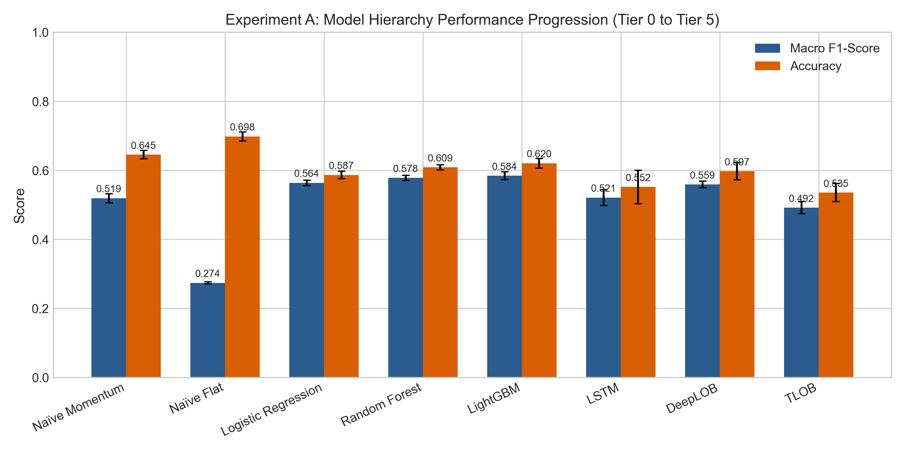

### Experiment B: Signal Decay Across Horizons (LightGBM)

| Horizon k | Macro-F1 | Naïve Momentum Macro-F1 | Accuracy | Test FLAT share |
|:---:|:---:|:---:|:---:|:---:|
| 10 | 0.521 ± 0.011 | 0.438 | 0.715 | 88.3% |
| 20 | **0.581 ± 0.011** | 0.519 | 0.614 | 69.8% |
| 50 | 0.534 ± 0.012 | 0.467 | 0.542 | 38.7% |
| 100 | 0.453 ± 0.013 | 0.413 | 0.508 | 22.1% |

Skill peaks at k = 20. At k = 10 most moves fall under the 1.5 bp threshold (88% FLAT), which makes UP/DOWN hard to recall. Beyond k = 20 the signal decays. The informed-flow bursts the generator plants last 15–60 events, which matches this shape.

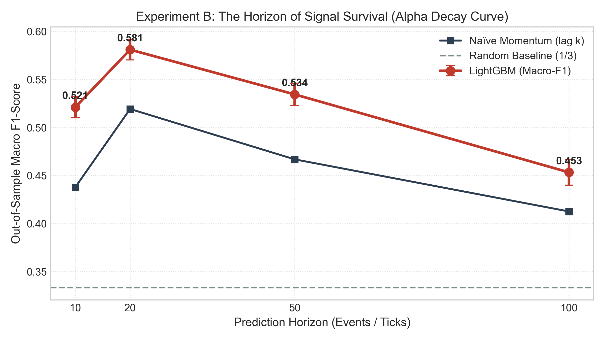

### Experiment C: Feature Ablation (LightGBM, k = 20)

| Feature set | # Features | Macro-F1 |
|:---|:---:|:---:|
| A: Spread only | 1 | 0.160 ± 0.102 |
| B: L1 snapshot (spread, L1 imbalance, L1 OFI, micro-price deviation) | 4 | 0.492 ± 0.011 |
| C: B + lags of L1 signals | 13 | 0.541 ± 0.006 |
| D: C + levels 2–3 (L3 imbalance, L2/L3 OFI) | 16 | 0.570 ± 0.008 |
| E: All features (adds L4–10 depth, slopes, MLOFI PCA, VPIN) | 27 | 0.581 ± 0.011 |

The spread is always one tick in this regime, so Model A carries no information. With balanced weights it collapses to a single class, and which class varies by seed (hence the large std). Short history adds +0.049 on top of the L1 snapshot, and levels 2–3 add +0.029. The rest of the book adds +0.011.

**Feature attribution** (share of total LightGBM split gain on the full model, mean over seeds): `imbalance_l3` 49.3%, `vpin` 7.5%, `ofi_pca1` 6.3%, `slope_bid` 5.3%, `slope_ask` 4.9%, `imbalance_l5` 4.1%, `ofi_lag_1` 4.0%, `imbalance_l1` 3.4%. Gain importance is a model-internal measure. It is not a causal attribution, and it splits credit arbitrarily between correlated features.

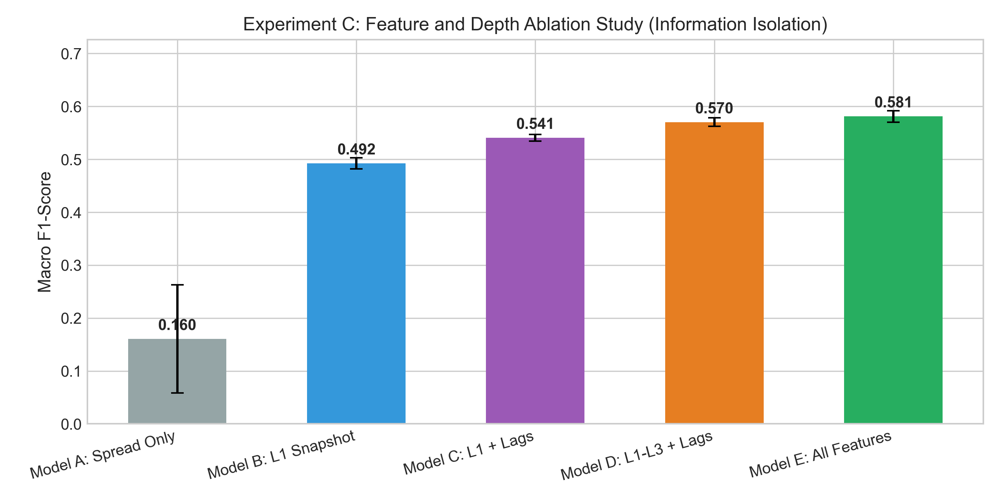

### Experiment D: Execution and Latency

The test-set signals of the trained LightGBM and DeepLOB models from Experiment A are executed over each seed's test window (8,980 events, about 89 s of simulated trading). Settings: $1M capital, 100-share lots, ±500 share inventory cap, 1.5 bp taker fee, 0.5 bp maker rebate, and 1 ms latency unless stated. Latency is applied in wall-clock time: an order reaches the book at the first snapshot whose timestamp is at least $t$ + latency. If an order is larger than the visible depth, by default the simulator extends the book past its last level, using the visible book's average level spacing and level size. It can also be set to fill partially or to reject the order, and it counts how often any of this happens (`overflow_policy` in [simulator.py](src/execution/simulator.py)).

| Model | Regime | Net PnL ($) | Trades | PnL / trade ($) | Fees ($) | Slippage vs decision mid ($) |
|:---|:---|:---:|:---:|:---:|:---:|:---:|
| LightGBM | Academic mid-price (fantasy) | 1,858 ± 136 | 658 | 2.86 | 0 | 0 |
| LightGBM | Aggressive taker | **457 ± 257** | 658 | 0.74 | 982 | 422 |
| LightGBM | Passive maker (VPIN gate) | 2 ± 31 | 4 | — | −2 | 0 |
| DeepLOB | Academic mid-price (fantasy) | 1,782 ± 142 | 797 | 2.25 | 0 | 0 |
| DeepLOB | Aggressive taker | 104 ± 160 | 797 | 0.14 | 1,186 | 501 |
| DeepLOB | Passive maker (VPIN gate) | 7 ± 173 | 11 | — | −5 | 0 |

- Crossing the spread and paying fees removes about 75% (LightGBM) and 94% (DeepLOB) of the fantasy PnL. DeepLOB's signals flip more often, so it trades more and pays more friction.
- The **passive maker** joins the touch and counts as filled only when the market trades *through* its price within 50 events (it assumes it sits at the back of the queue). It cancels when the signal flips or VPIN exceeds its 90th training-period percentile. Under this conservative rule almost nothing fills, and what does fill is adversely selected by construction. An earlier version assumed every passive order filled instantly at the touch, which is why it used to beat even the fantasy regime.
- **Sharpe ratios are not reported** in these tables. Annualizing about 90 seconds of returns gives numbers in the hundreds or thousands that mean nothing. The CSVs still contain a Sharpe computed on 100 ms bars for relative comparison.

**Latency sweep** (aggressive taker, added latency, net PnL mean ± std):

| Added latency | LightGBM | DeepLOB |
|:---:|:---:|:---:|
| 0 ms | 508 ± 255 | 155 ± 156 |
| 1 ms | 457 ± 257 | 104 ± 160 |
| 2 ms | 454 ± 258 | 100 ± 160 |
| 10 ms | 427 ± 267 | 71 ± 173 |
| 25 ms | 369 ± 265 | 14 ± 181 |
| 100 ms | 119 ± 278 | −247 ± 210 |

**Measured single-sample inference latency** (median, Python): LightGBM booster **0.14 ms** (CPU), DeepLOB **2.4 ms** (CUDA, batch of 1).

Interpretation: both models lose about the same amount per millisecond of latency (≈$390–400 from 0 to 100 ms). LightGBM's advantage over DeepLOB is already present at zero latency, so it comes from better signals, not faster inference. At the measured latencies, DeepLOB's extra ~2.3 ms costs about $10 (≈$109 at 0.14 ms vs ≈$99 at 2.4 ms), which is small next to the ~$350 signal-quality gap. The drop from 0 to 0.05 ms for both models is a discretization effect: at zero latency the order fills against the very snapshot the decision was made on, while any positive latency means the next event. In seed 0 DeepLOB edges out LightGBM. The seed-to-seed spread in PnL is large compared with the means, so treat the absolute numbers as indicative.

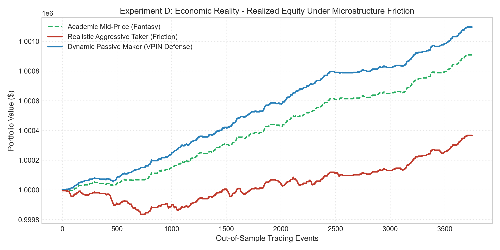
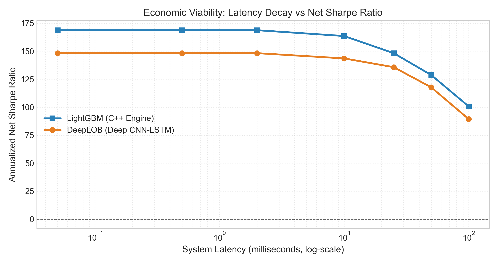

---

## Real-Data Results

The real datasets are wired in and tested. Runs that train deep models need a GPU and several hours, so they run on [Colab](#running-on-google-colab). The tabular and simulation experiments (G, H, I, and part 1 of J) run on a laptop CPU in minutes. Download the Kaggle datasets with `python scripts/fetch_datasets.py`.

| Dataset | Source | What the experiment does |
|:---|:---|:---|
| **Coinbase BTC-USD**, 15-level book, 1 s snapshots, ~12 days (Apr 2021) | [Kaggle, CC0](https://www.kaggle.com/datasets/martinsn/high-frequency-crypto-limit-order-book-data) | Reruns Experiments A–D on 4 contiguous ~3-day segments. Labels use a per-horizon threshold calibrated on training rows only (one third FLAT). VPIN comes from the real signed buy/sell volume. Execution uses Coinbase's top-tier fees (0 bp maker, 4 bp taker), 0.1 BTC lots, and a latency sweep in whole seconds (the book is only observed once a second). `python scripts/run_all_experiments.py --source btc`. Follow-ups: `python -m src.experiments.exp_e_tradability`, `python -m src.experiments.exp_f_cross_asset` |
| **FI-2010**, Setup 2 | [Kaggle mirror](https://www.kaggle.com/datasets/ulfricirons/fi-2010) of Ntakaris et al. (2018) | Trains on days 1–7 and tests on days 8–10. Compares our DeepLOB, LightGBM, logistic regression and baselines with the published DeepLOB numbers (84.47% accuracy / 83.40% weighted-F1 at k = 10). `python -m src.experiments.fi2010_benchmark` |
| **Optiver Realized Volatility** (Kaggle 2021) | [competition](https://www.kaggle.com/competitions/optiver-realized-volatility-prediction) | Book/trade volatility features. Recovers the shuffled time order with the [1st-place](https://www.kaggle.com/competitions/optiver-realized-volatility-prediction/writeups/nyanp-1st-place-solution-nearest-neighbors) tick-size + t-SNE trick, then validates forward in time. Compares the winner's nearest-neighbor features as published (neighbors drawn from all time windows, including future ones) with a past-only version, plus shuffled K-fold CV for contrast. `python -m src.experiments.optiver_rvp` |
| **LOBSTER sample files**: INTC, MSFT, AAPL, AMZN, GOOG, 21 June 2012, 9:30–16:00, 10 levels, every order event | [lobsterdata.com](https://lobsterdata.com) (free samples for academic use; not redistributed, so not on Kaggle) | Resampled onto a 100 ms clock. Decay curve at 100 ms–30 s, large- vs small-tick stocks, order-flow features, market making with execution-exact fills. Unzip the 10-level files into `data/raw/lobster/` and run `python -m src.experiments.exp_i_lobster` locally |
| **Optiver Trading at the Close** (Kaggle 2023) | [competition](https://www.kaggle.com/competitions/optiver-trading-at-the-close) | Auction-imbalance features, including the [1st-place](https://www.kaggle.com/competitions/optiver-trading-at-the-close/writeups/hyd-1st-place-solution) seconds-group and cross-sectional rank features. Uses the winner's split (first 400 days train, last 81 days holdout) and compares a model trained once with one retrained every 12 days. `python -m src.experiments.optiver_close` |

The Optiver data is competition data: accept each competition's rules on kaggle.com once before downloading.

### Coinbase BTC-USD: Experiments A–D

These use 4 contiguous segments of about 3 days each. Each segment is split 70/15/15 in time, and the tables give the mean ± std across segments. Horizons count 1-second snapshots, so k = 20 means 20 seconds ahead. The training split sets the label threshold so that a third of training rows are FLAT, which puts random guessing at about 0.333 macro-F1.

**Model hierarchy (k = 20)**

| Tier | Model | Accuracy | Macro-F1 |
|:---:|:---|:---:|:---:|
| 0 | Naïve Flat | 0.295 | 0.152 |
| 0 | Naïve Momentum (lag k) | 0.415 | 0.413 ± 0.021 |
| 1 | Logistic Regression | 0.463 | 0.448 ± 0.016 |
| 2 | Random Forest | 0.474 | 0.465 ± 0.017 |
| 3 | **LightGBM** | 0.476 | **0.467 ± 0.021** |
| 4 | LSTM | 0.448 | 0.397 ± 0.044 |
| 5 | DeepLOB | 0.429 | 0.401 ± 0.048 |
| 5 | TLOB | 0.455 | 0.449 ± 0.025 |

LightGBM beats DeepLOB on 4/4 segments (+0.067 on average), TLOB on 4/4 (+0.018) and logistic regression on 4/4 (+0.020). Its edge over Random Forest (+0.002, 3/4 segments) is noise. The learned models add about 0.05 macro-F1 over naive momentum, so the signal is real but small.

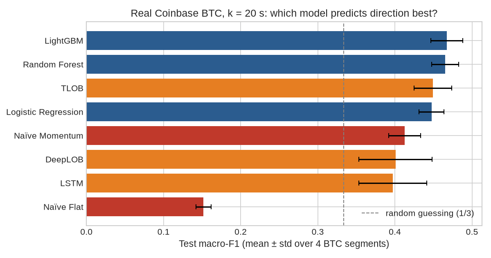

**Signal decay (LightGBM)**

| Horizon | Macro-F1 | Naïve Momentum |
|:---:|:---:|:---:|
| 10 s | 0.540 ± 0.020 | 0.463 |
| 20 s | 0.467 ± 0.021 | 0.413 |
| 50 s | 0.395 ± 0.015 | 0.367 |
| 100 s | 0.350 ± 0.012 | 0.358 |

Skill is highest at the shortest horizon and is gone by 100 s, where LightGBM no longer beats momentum.

**Feature ablation (LightGBM, k = 20)**

| Feature set | # Features | Macro-F1 |
|:---|:---:|:---:|
| A: Spread only | 1 | 0.237 ± 0.017 |
| B: L1 snapshot | 4 | 0.436 ± 0.016 |
| C: B + lags of L1 signals | 13 | 0.460 ± 0.019 |
| D: C + levels 2–3 | 16 | 0.464 ± 0.018 |
| E: All features | 27 | 0.467 ± 0.021 |

The top of the book carries most of the signal. Lags add +0.024, and everything past level 1 adds less than +0.01. By split gain, the leading features are `slope_ask` 15.1%, `slope_bid` 14.0%, `imbalance_l10` 9.9%, `vpin` 9.7%, `ofi_lag_1` 5.6% and `spread_ticks` 4.8%. The book-shape features score high on gain even though the ablation says they add little. Gain splits credit arbitrarily between correlated features, so it is not a causal attribution.

**Execution** (test-set signals, 0.1 BTC lots, ±0.5 BTC cap, 4 bp taker fee, 0 bp maker fee, 1 s latency)

| Model | Regime | Net PnL ($) | Trades | Fees ($) |
|:---|:---|:---:|:---:|:---:|
| LightGBM | Academic mid-price (fantasy) | 8,055 ± 988 | 15,595 | 0 |
| LightGBM | Aggressive taker | −36,394 ± 7,271 | 15,595 | 37,631 |
| LightGBM | Passive maker (VPIN gate) | −478 ± 776 | 755 | 0 |
| DeepLOB | Academic mid-price (fantasy) | 5,486 ± 961 | 13,337 | 0 |
| DeepLOB | Aggressive taker | −31,071 ± 10,144 | 13,337 | 31,809 |
| DeepLOB | Passive maker (VPIN gate) | −1,411 ± 253 | 896 | 0 |

- Fees alone are about 4.7× the fantasy profit. Both models lose about $2.3 per taker trade. DeepLOB loses less in total only because it trades less.
- Passive orders only fill when the price trades through them, which by construction is when the market moves against the order. Under this rule, so few orders fill that the strategy loses a little.
- **Latency barely matters here.** Raising the latency from 0 to 30 s moves LightGBM from −$34.5k to −$41.0k and DeepLOB from −$30.0k to −$34.8k, which is small next to the fees. Median single-sample inference takes 0.14 ms for LightGBM (CPU) and 5.7 ms for DeepLOB (CUDA). Both are far below the 1 s snapshot interval.

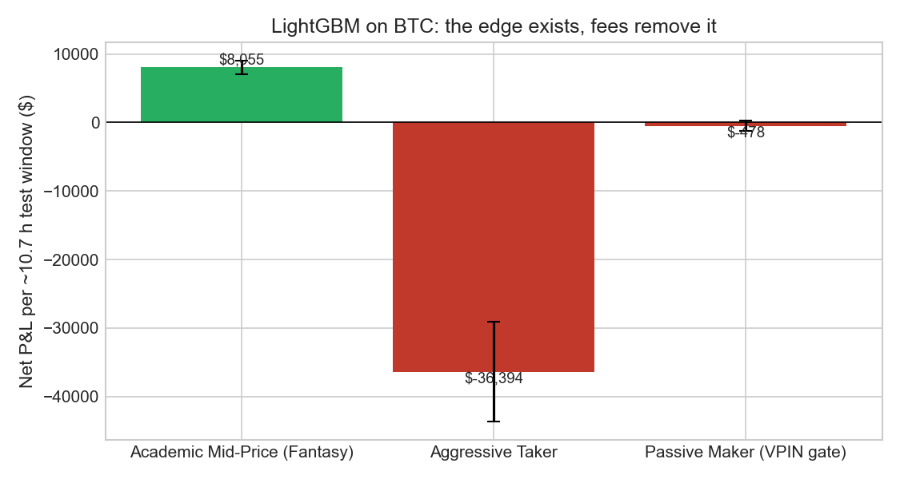

### BTC: can a filtered signal pay? (Experiment E)

Each signal is traded as a round trip. The model enters with a taker order at the next snapshot and exits with a taker order k seconds later, walking the book both times. It trades only the most confident share of rows ("coverage", with the threshold set on validation data). *Direction* labels are the labels used above. *Cost-aware* labels mark UP only if buying at the ask and selling at the bid k seconds later would beat a 4 bp fee per side (DOWN is symmetric). Gross is in bp per round trip after the spread and book walking, before fees.

| Labels | Hold | Coverage | Trades / segment | Mid move (bp) | Gross (bp) |
|:---|:---:|:---:|:---:|:---:|:---:|
| Direction | 20 s | 100% | 1,667 | 0.92 | −0.03 |
| Direction | 20 s | 5% | 701 | 2.21 | 0.55 |
| Direction | 20 s | 1% | 250 | 2.42 | 0.58 |
| Cost-aware | 60 s | 2% | 168 | 1.92 | **0.70** |
| Cost-aware | 300 s | 100% | 123 | −0.52 | −1.19 |

Confident signals do catch bigger moves (about 2 bp of mid move against 1 bp), but execution eats most of them. The best gross edge is 0.70 bp, against 8 bp needed to break even at 4 bp per side. At 1 bp per side the best setting still nets −1.3 bp. Full grid: [tradability_summary.csv](artifacts/btc/tradability/tradability_summary.csv).

**Where the edge goes.** [decompose_btc_edge.py](scripts/decompose_btc_edge.py) splits each round trip (direction labels, 20 s hold) into the edge at the decision mid, the cost of entering one snapshot (1 s) later, and the cost of crossing the spread and walking the book ([csv](artifacts/btc/tradability/edge_decomposition.csv)):

| Coverage | Edge at decision mid | 1 s delay | Crossing | Gross | Hit rate | Break-even hit rate at 0 / 1 / 4 bp fee |
|:---:|:---:|:---:|:---:|:---:|:---:|:---:|
| 100% | 1.01 bp | −0.27 | −0.73 | 0.01 | 60.7% | 63% / 90% / over 100% |
| 10% | 1.97 bp | −0.65 | −0.89 | 0.43 | 68.9% | 68% / 92% / over 100% |
| 2% | 2.23 bp | −0.75 | −1.01 | 0.47 | 71.8% | 70% / 94% / over 100% |

The quoted spread is only part of the crossing cost (about 0.2 bp per round trip on average); the rest is walking the book for 0.1 BTC. The most confident signals lose almost three times as much to the one-second delay as the average signal, because they predict the moves that come soonest. And the average absolute 20 s move on these rows is about 4.3 bp, so even a perfect direction forecast could not cover the 8 bp taker round trip. Break-even hit rate is 1/2 + cost / (2 × average absolute move); the [final report](submission/PROJECT_REPORT.md#52-where-exactly-does-the-edge-go) explains it.

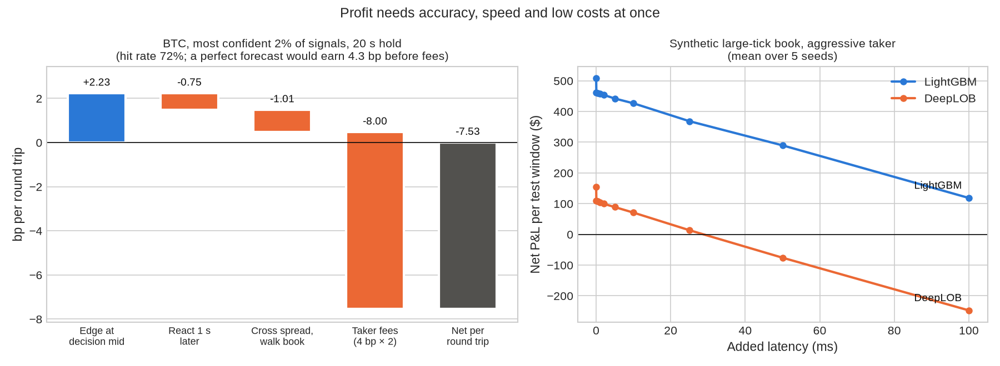

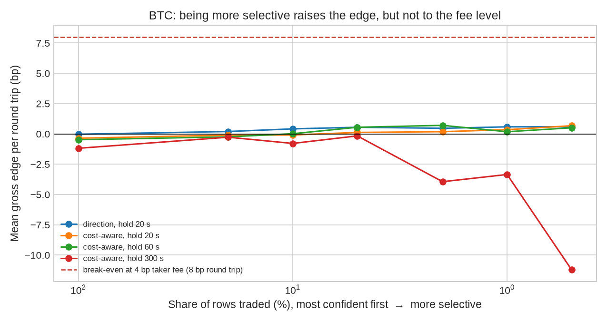

### BTC: does Ethereum's book help? (Experiment F)

The same LightGBM is trained on identical splits, with and without ETH-USD book features. The ETH features use the latest ETH snapshot at or before each BTC timestamp.

| Horizon | BTC only | + ETH | Δ macro-F1 | Segments improved | ETH share of gain |
|:---:|:---:|:---:|:---:|:---:|:---:|
| 10 s | 0.540 | 0.556 | +0.016 ± 0.007 | 4/4 | 26.5% |
| 20 s | 0.467 | 0.480 | +0.012 ± 0.005 | 4/4 | 31.0% |
| 50 s | 0.395 | 0.402 | +0.007 ± 0.008 | 4/4 | 33.6% |

The gain is small but consistent, and it fades with horizon. That pattern fits ETH leading BTC by a few seconds.

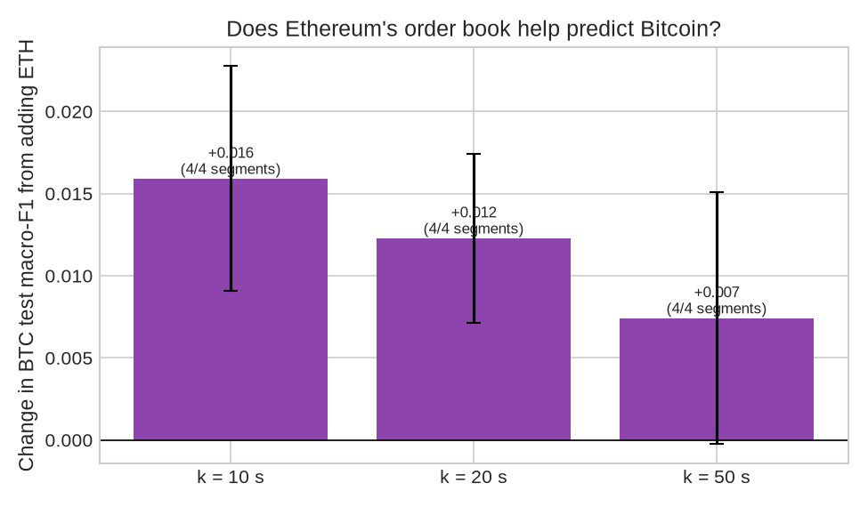

### BTC: does the edge survive in any regime? (Experiment G)

Spec section 8 asks for market regimes where the edge survives costs, for example periods of toxic order flow. This experiment splits Experiment E's trades by terciles of three variables known at decision time: VPIN, the quoted spread, and realized volatility over the previous 60 s. Cut-offs come from each segment's training rows. Each cell is a strategy that trades only inside that regime. Gross is bp per round trip after the spread, before fees; the 95% CI is a moving-block bootstrap over the pooled trades of all 4 segments ([full table](artifacts/btc/regimes/regime_tradability.csv)).

| Signal (coverage) | Regime | Trades | Gross (bp) | 95% CI | Segments gross > 0 |
|:---|:---|:---:|:---:|:---:|:---:|
| Direction, all signals | low volatility | 1,980 | +0.46 | 0.28 to 0.65 | 4/4 |
| Direction, all signals | high volatility | 3,065 | −0.45 | −0.68 to −0.23 | 0/4 |
| Direction, top 2% | low volatility | 413 | +1.08 | 0.73 to 1.47 | 4/4 |
| Direction, top 2% | high VPIN | 676 | +0.50 | −0.02 to 1.02 | 3/4 |
| Cost-aware, top 2% | high VPIN | 336 | **+1.43** | 0.24 to 2.84 | 3/4 |
| Cost-aware, top 2% | low volatility | 193 | +1.32 | 0.49 to 2.54 | 3/4 |

- **No regime survives costs.** The best cell earns +1.43 bp gross. At 1 bp fee per side (2 bp per round trip) it still nets −0.57 bp, and at the 4 bp taker fee a round trip needs 8 bp.
- **The edge is most consistent in calm markets.** Low volatility is positive before fees at every coverage, on all 4 segments, for the direction model. It is also where predictability is highest (macro-F1 0.483 vs 0.443 in high volatility).
- **Toxic flow does not help.** Macro-F1 is the same in every VPIN tercile (0.467–0.468), and high VPIN is the best cell for only one of the two models. The spec's idea that toxicity regimes are where the edge survives is not supported here.
- The table covers 54 cells, so a few confidence intervals will exclude zero by chance. The low-volatility result holds across coverages, segments and both models.

### BTC: market making with an adverse-selection model (Experiment H)

Spec section 6.2 proposes earning the spread with resting quotes, and modelling the adverse selection those quotes suffer. For every snapshot, the experiment labels a hypothetical 0.1 BTC quote at the touch on each side (resting up to 30 s) with whether it fills and its markout: the mid price 30 s after the fill relative to the fill price. LightGBM learns the value of posting from the microstructure features plus new order-flow features (limit, market and cancel notional per level). Three strategies then quote both sides with a ±0.5 BTC inventory limit:
- **always:** quote both sides all the time;
- **rule:** the spec's Scenario A/B: quote when the spread is at least its training median and VPIN is below its training 67th percentile, and cancel when VPIN exceeds its 90th percentile;
- **model:** quote a side only when the predicted value of posting clears a threshold chosen on validation data.

One-second snapshots cannot show queue position, so each strategy runs under three fill rules that bracket the truth. *Pessimistic* fills only when the price trades through the quote. *Queue* fills once recorded market flow at the quote's price exceeds the resting size ahead of it. *Optimistic* assumes the front of the queue. Net P&L per test window (about 10.7 h), mean ± std over 4 segments, 0 bp maker fee, leftover inventory closed at the 4 bp taker fee ([csv](artifacts/btc/market_making/mm_summary.csv)):

| Strategy | Pessimistic | Queue | Optimistic | Segments > 0 |
|:---|:---:|:---:|:---:|:---:|
| always | −$4,677 ± 57 | −$4,638 ± 68 | −$4,509 ± 115 | 0/4 under every rule |
| rule (spec Scenario A/B) | −$1,562 ± 1,033 | −$1,562 ± 1,019 | −$1,445 ± 1,103 | 0/4 |
| model | −$670 ± 778 | −$501 ± 818 | +$81 ± 718 | 0, 1 and 2 of 4 |

- **Naive quoting loses about $10,400 per day.** The average fill loses 1.7–1.9 bp 30 s later under the pessimistic and queue rules, and 0.6–0.8 bp even at the front of the queue.
- **The spec's rule cuts losses by about two thirds; the model by 86% or more,** but the model only breaks even under the optimistic rule, and that result is indistinguishable from zero.
- **Adverse selection is only weakly predictable.** Given a fill, a LightGBM classifier tells toxic fills (negative markout) from good ones with an AUC of 0.55–0.58.
- **VPIN does not sort fills.** Markouts by VPIN tercile show no consistent pattern; low-VPIN bid fills are the worst (−2.25 bp under the pessimistic rule).
- **Why it fails:** BTC trades in $0.01 steps at about $60,000, so the spread is 0.0017 bp and sits at one tick 80% of the time. A typical one-second move is 0.5 bp. There is no spread to earn, only adverse selection to absorb. This is spec section 1's small-tick case, measured.
- The Coinbase per-level market-order columns add up to only about 30–40% of the traded volume, so the queue rule here behaves almost like the pessimistic one. The fill rules are bounds, not estimates.

### LOBSTER: Nasdaq event data, large- vs small-tick stocks (Experiment I)

LOBSTER's free sample files contain every order event for five Nasdaq stocks on 21 June 2012 (10 levels, 9:30–16:00). The experiment resamples them onto a 100 ms clock, which makes the spec's horizons (100 ms to 30 s) possible on real data. The stocks fall cleanly into the two regimes of spec section 1:

| | Tick as share of price | Spread at one tick | Median shares at best level | Mid-price changes per minute |
|:---|:---:|:---:|:---:|:---:|
| INTC, MSFT (large tick) | 3.3–3.7 bp | 77% of the time | ~13,000 | 8–10 |
| AAPL, AMZN, GOOG (small tick) | 0.17–0.45 bp | under 1% | ~100 | 60–165 |

**Decay curve.** Best learned model (logistic regression, LightGBM, or LightGBM with order-flow features) minus naive momentum, macro-F1 on the test period ([full table](artifacts/lobster/lobster_prediction.csv)):

| Stock | 100 ms | 500 ms | 1 s | 5 s | 10 s | 30 s |
|:---|:---:|:---:|:---:|:---:|:---:|:---:|
| INTC (large) | −0.004 | +0.019 | +0.050 | **+0.113** | +0.098 | −0.025 |
| MSFT (large) | −0.005 | +0.036 | **+0.071** | +0.042 | +0.008 | +0.008 |
| AAPL (small) | −0.020 | +0.022 | +0.019 | +0.003 | +0.027 | +0.059 |
| AMZN (small) | −0.066 | −0.047 | −0.008 | −0.042 | −0.029 | −0.022 |
| GOOG (small) | −0.085 | −0.040 | −0.027 | −0.035 | −0.036 | +0.009 |

- **Large-tick stocks are more predictable**, as the spec expects. On INTC and MSFT the learned models beat momentum from 500 ms to 10 s, peaking at 1–5 s (INTC at 5 s: 0.457 vs 0.344).
- **Nothing is predictable at 100 ms on large-tick stocks** because the mid price almost never moves: 99% of INTC's and MSFT's 100 ms test labels are FLAT. The spec expected the peak in the sub-second range; on this data it comes later.
- **On small-tick stocks the learned models mostly lose to naive momentum** (AMZN and GOOG at almost every horizon). Their books change so fast that the last move is a strong baseline.
- **Order-flow features help only small-tick stocks:** adding limit, market and cancel flows to LightGBM gains +0.011 macro-F1 on average for AAPL, AMZN and GOOG, and −0.003 for INTC and MSFT.

**Market making.** Experiment H's setup with 100-share lots, a ±500-share inventory limit, quotes resting up to 30 s, and Nasdaq-style 2012 pricing (assumed 0.30 cents per share to take liquidity, a 0.20 cent rebate to provide it). LOBSTER records every execution with its price, so the queue rule is exact except for cancellations ahead in the queue. Mean markout per fill 30 s later, in bp after the rebate ([csv](artifacts/lobster/lobster_adverse_selection.csv)):

| Stock | Pessimistic | Queue | Optimistic (front of queue) |
|:---|:---:|:---:|:---:|
| INTC (large) | −2.22 | −2.15 | +1.24 |
| MSFT (large) | −1.78 | −1.78 | +0.70 |
| AAPL (small) | +0.14 | +0.17 | +0.21 |
| AMZN (small) | +0.52 | +0.55 | +0.67 |
| GOOG (small) | −0.13 | −0.03 | +0.03 |

- **On large-tick stocks, queue position decides everything.** A fill at the front of the queue earns +0.7 to +1.2 bp (about 0.7 bp of that is the rebate on INTC); a fill at the back loses about 2 bp. With ~13,000 shares queued at the best price, a newly posted order is nearly always at the back, so the queue rule matches the pessimistic one. This is why high-frequency firms compete for queue priority.
- **On small-tick stocks the touch is often wide** (13–30 ticks on average), so joining it can earn a little: AMZN and AAPL fills are slightly positive under every rule.
- **Adverse selection is not predictable here** (AUC 0.39–0.53), and the dollar P&L comes from a single test window of about one hour dominated by inventory moves, so it is illustrative only ([csv](artifacts/lobster/lobster_market_making.csv)).
- One day per stock, and the test period is the last hour of the session, which trades differently from the rest of the day. Treat all LOBSTER numbers as a single-day case study.

### BTC: attribution and significance (Experiment J)

Spec sections 5.1 and 5.3 ask whether improvements over the baselines are statistically significant, and for SHAP-style attribution. Experiment J retrains Experiment A's tabular models on each BTC segment (k = 20 s) with the same settings and keeps their per-row test predictions. DeepLOB is retrained the same way on a GPU (Colab, `--deeplob`).

**Significance** of LightGBM's macro-F1 advantage, pooled over the 4 segments. The CI is a moving-block bootstrap (5-minute blocks, segments resampled separately); McNemar's test compares which rows each model gets right ([csv](artifacts/btc/attribution/significance_vs_lightgbm.csv)):

| LightGBM vs | Macro-F1 difference | 95% CI | Segments LightGBM better | McNemar p |
|:---|:---:|:---:|:---:|:---:|
| Naive momentum | +0.059 | 0.050 to 0.068 | 4/4 | < 0.0001 |
| Logistic regression | +0.019 | 0.015 to 0.024 | 4/4 | < 0.0001 |
| Random Forest | +0.004 | 0.001 to 0.007 | 3/4 | 0.015 |
| DeepLOB | +0.058 | 0.049 to 0.068 | 4/4 | < 0.0001 |

LightGBM is significantly better than all four, but its edge over Random Forest is tiny. DeepLOB, trained on the raw book, is about as far behind LightGBM as naive momentum is. (Retrained here, DeepLOB trails by +0.058; Experiment A's run gave +0.067.)

**TreeSHAP** (exact, from LightGBM's `pred_contrib`, on 20,000 test rows per segment), share of mean |SHAP| by feature group, next to Experiment C's gain shares ([groups](artifacts/btc/attribution/shap_lightgbm_groups.csv), [features](artifacts/btc/attribution/shap_lightgbm_features.csv)):

| Feature group | SHAP share | Gain share |
|:---|:---:|:---:|
| Deeper book (slopes, L5/L10 imbalance, OFI PCA) | 39.3% | 47.1% |
| L1 lags (OFI, imbalance, micro-price) | 34.6% | 25.2% |
| L1 snapshot | 14.1% | 13.6% |
| VPIN | 6.6% | 9.7% |
| Levels 2–3 | 5.4% | 4.5% |

- SHAP gives the recent history of level-1 signals much more weight than gain importance did (35% vs 25%), which fits the ablation (lags were the biggest single addition). The book-shape features still lead, led by `slope_ask` (12.3%) and `slope_bid` (11.8%).
- **Confusion matrices** ([csv](artifacts/btc/attribution/confusion_matrices.csv)): FLAT is the hardest class for every model. LightGBM recalls 40% of FLAT, 50% of UP and 52% of DOWN rows; naive momentum 39%, 44% and 42%. The tabular models spread their errors fairly evenly across the other two classes. DeepLOB does not: it recalls only 30% of FLAT rows and calls 41% of them DOWN, and it recalls DOWN (54%) much better than UP (42%), so part of its score comes from leaning toward one direction.

**DeepLOB attribution** (gradient × input for the predicted class, on 2,000 test windows of 100 snapshots per segment; shares of the total, mean over 4 segments; [csv](artifacts/btc/attribution/deeplob_attribution.csv)):

| What the network looks at | Share |
|:---|:---:|
| Order sizes (vs prices; partly a scaling effect, see below) | 84% (69–93% by segment) |
| Level 1 | 18% |
| Each of levels 2–10 | about 9% |
| The most recent 10 of the 100 snapshots | 57% (40–79%) |
| Ask side (vs bid) | 52% |

- **Like LightGBM, DeepLOB relies on queue sizes and on recent history.** Level 1 counts twice as much as any other level, and more than half the weight falls on the last 10 seconds of a 100-second window. That matches the ablation (level-1 signals and their short lags carry most of LightGBM's skill) and the decay curve (skill fades within tens of seconds).
- **Deeper levels get almost equal weight each**, so the network uses the overall depth profile rather than any particular level. LightGBM gets the same information more compactly from the book-slope and deep-imbalance features (39% of its SHAP).
- **The sizes-vs-prices split is partly built in.** Gradient × input grows with the size of the input. Prices enter as their relative distance from a fixed reference price (a few percent), while sizes enter log-scaled around 1, so prices are bound to score lower. Compare levels and time steps with each other; don't read the 84% as a causal effect. The level and recency patterns compare like with like, so they are the robust findings.

### Micro-price as a target (Experiment K)

Spec section 3.3 calls the gap between the mid price and the micro-price "an additional, highly effective target variable". The micro-price here is the imbalance-weighted mid, so the gap is micro − mid = I × spread / 2, with I the level-1 queue imbalance. Experiment K asks three questions on BTC (4 segments) and LOBSTER (5 stocks), from 500 ms to 50 s ahead ([summary](artifacts/microprice/microprice_summary.csv), [betas](artifacts/microprice/microprice_beta_summary.csv)):

**1. Does the mid price move toward the micro-price?** β is the slope of the future mid change on today's gap, fitted on training rows: β = 1 means the gap has fully closed.

| Horizon | Large-tick β (INTC, MSFT) | Small-tick β (AAPL, AMZN, GOOG) | BTC β |
|:---:|:---:|:---:|:---:|
| 500 ms | 0.12 | 0.01 | — |
| 1 s | 0.22 | 0.02 | — |
| 5 s | 0.68 | 0.03 | — |
| 10 s | 0.93 | 0.03 | 0.38 |
| 30 s | 1.32 | 0.00 | — |
| 50 s | — | — | 0.69 |

On large-tick stocks the gap closes fully within about 10 s, and by 30 s the mid moves *further* than the gap (β > 1), a sign that the simple weighted mid understates where the price is going. Stoikov's full micro-price corrects for this. On small-tick stocks the gap barely closes. On BTC it closes partly, but at 0.06 bp it is tiny next to 2–6 bp moves.

**2–3. Is the micro-price a better target?** Information coefficient (IC, correlation of the forecast with the realized future *mid* change) on the test period:

| | Large-tick 5 s | Large-tick 10 s | Small-tick 1 s | BTC 10 s |
|:---|:---:|:---:|:---:|:---:|
| Micro-price rule (β × gap, one parameter) | **0.290** | **0.278** | 0.062 | 0.024 |
| Momentum (past k-step return) | 0.037 | 0.012 | 0.042 | 0.074 |
| LightGBM trained on future mid change | 0.209 | 0.170 | **0.155** | **0.263** |
| LightGBM trained on future micro-price change | 0.080 | 0.009 | −0.007 | 0.260 |
| Control (LightGBM on shuffled targets) | −0.003 | 0.005 | −0.003 | 0.002 |

- **As a predictor, the gap is excellent where the tick is large.** On INTC and MSFT the one-parameter rule matches or beats LightGBM with about 40 features from 5 s on, and gets the direction of the mid's next move right 64–82% of the time (82% at 500 ms, falling to 64% at 30 s). LightGBM falls behind it at longer horizons, possibly because the morning training session differs from the last-hour test period.
- **As a training target, it is worse than the mid itself.** Trained on future micro-price changes and judged on future mid changes, LightGBM was never significantly better than the model trained on the mid directly: significantly worse in 21 of 37 cases (all large-tick cases, 11 of 15 small-tick cases; block-bootstrap 95% CIs) and indistinguishable on BTC, where the micro-price and the mid are almost the same.
- **Easier to predict is not the same as useful.** On small-tick stocks, up to 10 s ahead, the micro-price's own future change is much more predictable than the mid's (R² 0.06–0.08 vs 0.00–0.02), because it moves with queue sizes that revert. That predictability does not carry over to the price.
- **The control behaves.** LightGBM trained on shuffled targets (training and validation, 3 shuffles) scores IC −0.0005 averaged over all 37 cases. `python scripts/check_microprice_results.py` runs this and 18 other automatic checks on the results.

### FI-2010 Setup 2

The models train on days 1–7 and are tested on days 8–10. Accuracy (%), mean ± std over 3 training seeds:

| k | Naïve Flat | Logistic | LightGBM | Logistic + history | LightGBM + history | DeepLOB (ours) | DeepLOB (published) |
|:---:|:---:|:---:|:---:|:---:|:---:|:---:|:---:|
| 10 | 70.7 | 70.8 | 53.2 | **86.1** | 78.0 ± 0.6 | 83.1 ± 0.3 | 84.5 |
| 20 | 62.1 | 64.1 | 47.2 | **78.3** | 56.6 ± 0.0 | 74.1 ± 0.5 | 74.8 |
| 50 | 47.3 | 43.9 | 44.1 | 66.5 | 64.4 ± 0.0 | **78.2 ± 0.2** | 80.5 |
| 100 | 34.4 | 40.0 | 42.8 | 60.2 | 75.7 ± 0.1 | **77.5 ± 0.4** | — |

*History* adds lagged changes of the 40 raw book columns to the 144 handcrafted features. Logistic regression has no spread because its solver is deterministic and the test days are fixed. The seeds only vary DeepLOB's and LightGBM's training, and that variation is small (at most 0.6 points).

- **Short horizons: simple features with history beat DeepLOB.** At k = 10, logistic regression with history scores 86.1% against 83.1 ± 0.3% for our DeepLOB (and 84.5% published). At k = 20 it is 78.3% against 74.1 ± 0.5%. The gap is several times the seed-to-seed spread, so it is not a lucky seed. DeepLOB's short-horizon advantage over snapshot features comes mostly from seeing a window of past books, not from its architecture.
- **Long horizons: DeepLOB wins clearly.** At k = 50 it leads by 12 points, and at k = 100 by 1.8 points over LightGBM with history.
- **Our DeepLOB reproduces the paper** to within 0.7–2.3 points.

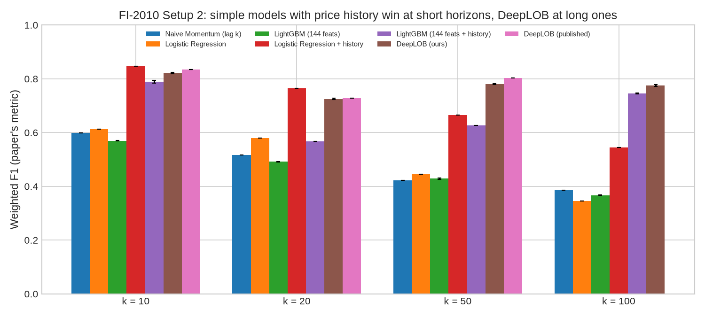

**Why LightGBM + history fails at k = 20 (and underperforms at k = 10).** [diagnose_fi2010_lightgbm.py](scripts/diagnose_fi2010_lightgbm.py) retrained it with early stopping and at fixed numbers of boosting rounds ([csv](artifacts/fi2010/diagnose_lightgbm_history.csv)):

| k | Rounds | Validation acc. | Test acc. | Predicted FLAT share on test | Actual FLAT share on test |
|:---:|:---:|:---:|:---:|:---:|:---:|
| 10 | 10 | 85.9% | 87.7% | 82% | 71% |
| 10 | 356 (early stopping) | 86.0% | 77.4% | 62% | 71% |
| 20 | 10 | 87.2% | 54.5% | 29% | 62% |
| 20 | 446 (early stopping) | 87.6% | 56.7% | 28% | 62% |

- **It is not an early-stopping bug.** At k = 20 the test accuracy is 54–57% at every number of rounds.
- **Validation accuracy does not predict test accuracy.** It sits at 86–88% for every setting, while test accuracy ranges from 55% to 88%. The validation days cannot tell good models from bad ones here.
- **The test days are calmer than the training days.** FLAT makes up 60% (k = 10) and 49% (k = 20) of training labels, but 71% and 62% of test labels. LightGBM learns to call moves from the size of recent book changes on the training days, and on the calmer test days it predicts far too few FLATs (28% against 62% at k = 20). Logistic regression is linear and degrades much less under this shift.
- **The 87.7% at 10 rounds is not a valid result.** It was found by looking at test accuracy, which is exactly what a benchmark must not do. It does show that LightGBM *can* use these features well. A volatility-normalized version of the history features is the natural next test.

### Optiver Realized Volatility

The time order is recovered with the 1st-place trick, and the models are validated on 4 forward-in-time folds. RMSPE (lower is better):

| Model | RMSPE |
|:---|:---:|
| Naïve (current realized volatility) | 0.337 ± 0.017 |
| LightGBM (book/trade features) | 0.235 ± 0.012 |
| + nearest-neighbour features, past-only | 0.223 ± 0.014 |
| + nearest-neighbour features, 1st-place style (uses future windows) | 0.214 ± 0.014 |
| LightGBM, shuffled K-fold CV | 0.214 ± 0.009 |

Restricting neighbours to the past keeps about 59% of the nearest-neighbour gain (0.0125 of 0.0212). Shuffled K-fold CV makes the plain model look as good as the leaky one. Volatility is far more predictable than direction: the model cuts the naïve error by about 30%. Early stopping uses a held-out slice of the training ids, never the scored fold. The earlier run that stopped on the scored fold is kept for reference in [rvp_summary_v1_early_stop_on_scored_fold.csv](artifacts/optiver_rvp/rvp_summary_v1_early_stop_on_scored_fold.csv).

### Optiver Trading at the Close

This uses the winner's split: train on the first 400 days, hold out the last 81. MAE on the holdout:

| Model | MAE |
|:---|:---:|
| Zero prediction | 5.994 |
| LightGBM, trained once | 5.856 |
| LightGBM, trained once + demean | 5.853 |
| LightGBM, retrained every 12 days + demean | **5.848** |

The model improves on predicting zero by about 2.4%. Retraining helps only marginally. The top features are `market_urgency` (11.8% of gain), `seconds_in_bucket`, `liquidity_imbalance` and the reference-price/WAP imbalances.

---

## C++20 Latency Benchmark

[main_benchmark.cpp](cpp/src/main_benchmark.cpp) times feature extraction plus tree-ensemble inference plus a simulated order on 100,000 snapshots from a random-walk book.

**Scope.** The ensemble is **randomly generated** (50 trees × 3 classes, depth 6, 10 real features plus 6 zero inputs). It is not the trained LightGBM model, and C++ features are not checked against the Python pipeline. The numbers measure the cost of evaluating a tree ensemble of that size. They are not the latency of the model evaluated above, and they do not include network or market-data parsing ("wire-to-order").

Latest run ([artifacts/cpp_latency_benchmarks.csv](artifacts/cpp_latency_benchmarks.csv), GCC 15.2, `-O3 -march=native`):

| Stage | P50 | P99 |
|:---|:---:|:---:|
| Feature extraction | below timer resolution | 0.2 µs |
| Tree inference | 1.8 µs | 6.1 µs |
| End-to-end loop | 1.9 µs | 6.3 µs (P99.9 15.1 µs) |

Throughput: about 399k snapshots/s, including timing overhead.

**Trained model in C++.** [benchmark_trained_model.py](scripts/benchmark_trained_model.py) exports the LightGBM model trained on BTC segment 0 (k = 20) and generates C++ code for it. [trained_model_benchmark.cpp](cpp/src/trained_model_benchmark.cpp) then checks the C++ output against LightGBM on 20,000 test rows. The model has 109 boosting rounds × 3 classes (327 trees, 20,601 leaves) on 27 features. The C++ scores match LightGBM exactly (max abs diff 0, 100% argmax agreement). Single-row latency is 10.5 µs at P50 and 17.9 µs at P99 ([csv](artifacts/cpp_trained_model_benchmark.csv)). This run was taken while other jobs were using the CPU, so treat the timings as an upper bound. The [tutorial](cpp/tutorial/) and [optimization_comparison.cpp](cpp/src/optimization_comparison.cpp) compare AoS vs SoA layouts and branchless tree evaluation on the same kind of synthetic ensemble.

---

## Repository Structure

```
ML_Project_2026/
├── README.md
├── cpp/                                    # C++20 latency benchmark & SIMD tutorial
│   ├── LEARNING_PATH.md                    # Self-study path: CPU basics to kernel bypass and tick-to-trade
│   └── labs/                               # Runnable experiments for the learning path (labs 01-08)
├── src/
│   ├── config.py
│   ├── data/
│   │   ├── synthetic_generator.py          # Simulated LOB, trade tape, timestamps, labels
│   │   ├── lob_dataset.py                  # Purged splits, indexed sequence loaders
│   │   ├── normalizers.py                  # Decimal, causal rolling z, BiN
│   │   ├── purged_cv.py                    # Purged & embargoed CV
│   │   ├── lobster_loader.py               # LOBSTER files; one day resampled onto a fixed clock
│   │   ├── crypto_loader.py                # Coinbase snapshots, trade tape, per-level order flows
│   │   └── fi2010_loader.py
│   ├── microstructure/                     # OFI, VPIN, micro-price, feature pipeline
│   ├── models/                             # Baselines, RF, LightGBM, LSTM, DeepLOB, TLOB, trainer
│   ├── execution/                          # Simulator, strategies, performance metrics
│   ├── experiments/
│   │   ├── common.py                       # Sessions (synthetic seeds / BTC segments), train-only fit, purged splits
│   │   ├── exp_a ... exp_d                 # Experiments A-D
│   │   ├── exp_e_tradability.py            # BTC: confidence filtering, cost-aware labels
│   │   ├── exp_f_cross_asset.py            # BTC: does ETH's book help?
│   │   ├── exp_g_regimes.py                # BTC: does the edge survive in any regime?
│   │   ├── exp_h_market_making.py          # BTC: market making with an adverse-selection model
│   │   ├── exp_i_lobster.py                # LOBSTER: decay curve, tick regimes, market making
│   │   ├── exp_j_attribution.py            # BTC: TreeSHAP, significance tests, DeepLOB attribution
│   │   ├── exp_k_microprice.py             # Micro-price gap as predictor and as target (BTC, LOBSTER)
│   │   ├── fi2010_benchmark.py             # FI-2010 Setup 2 vs published DeepLOB
│   │   ├── optiver_rvp.py                  # Optiver Realized Volatility (forward CV, NN features)
│   │   └── optiver_close.py                # Optiver Trading at the Close (date split, retraining)
│   └── utils/                              # Metrics, validation checks, plots
├── scripts/
│   ├── run_all_experiments.py              # Multi-seed runner (aggregated + per-seed artifacts)
│   ├── verify_robustness_and_leakage.py    # Validation report
│   ├── fetch_datasets.py                   # Downloads the real datasets from Kaggle
│   ├── sync_checkpoints.py                 # Moves run checkpoints between laptop and Colab
│   ├── make_real_data_figures.py           # Figures for the real-data results
│   ├── benchmark_trained_model.py          # Trained LightGBM -> C++ codegen + benchmark
│   ├── diagnose_fi2010_lightgbm.py         # Why FI-2010 LightGBM + history fails at k=20
│   ├── decompose_btc_edge.py               # BTC round trip: signal vs delay vs crossing cost, break-even hit rate
│   ├── check_microprice_results.py         # Automatic checks on Experiment K's results
│   ├── lgbm_to_cpp.py                      # Trained LightGBM -> C++ code generator
│   ├── build_and_execute_notebook.py       # Builds and runs the submission notebook
│   └── download_or_generate_data.py
├── notebooks/colab_run_all.ipynb           # One-click Colab runner for everything
├── submission/                             # Final project report, executed notebook, submission.csv
├── tests/
├── reports/                                # Project outcome and explainer write-ups
├── research_notes/                         # Literature and design notes
└── artifacts/                              # CSVs and figures (btc/, fi2010/, lobster/, optiver_*/, figures_real/)
```

---

## Running on Google Colab

The heavy runs (BTC, FI-2010, Optiver) need a GPU and several hours, so they are set up to run on Colab: open [notebooks/colab_run_all.ipynb](https://colab.research.google.com/github/aaravsin-1/ML_Project_2026/blob/master/notebooks/colab_run_all.ipynb) and choose **Runtime → Run all**. The notebook restores finished results from the repo and the `run-state` branch, downloads only the datasets that pending steps need, and skips every experiment whose results already exist (the `RUN` / `FORCE` settings at the top change this). A failing step is reported in the summary without stopping the rest.

1. **Runtime → Change runtime type → T4 GPU.**
2. Add your Kaggle API key as two Colab **Secrets** (🔑 panel): `KAGGLE_USERNAME` and `KAGGLE_KEY`. The values are in the `kaggle.json` from *kaggle.com → Settings → API → Create New Token*.
3. For the Optiver data, accept both competitions' rules on kaggle.com with the same account.
4. If the repo is private, also add a `GITHUB_TOKEN` secret with read access.

The notebook also has steps for Experiments G and H (CPU, usually already run on the laptop) and for Experiment J's DeepLOB part, which needs the GPU. The LOBSTER experiment (I) is not in the notebook because its data is not on Kaggle; it runs locally.

Results and checkpoints go to Google Drive (`MyDrive/ML_Project_2026/artifacts`). Every long run checkpoints after each segment or horizon, so after a disconnect you just rerun the setup cells and the experiment cell. The last cell downloads the results as a zip to unzip into `artifacts/` locally.

**Moving a run between machines.** Every long experiment checkpoints its progress (BTC per segment, FI-2010 per horizon, Optiver Close per training stage, Optiver RVP per fold and model). `python scripts/sync_checkpoints.py --loop 600` pushes the artifacts folder (checkpoints and results, never raw data) to the repo's `run-state` branch every 10 minutes. The notebook's "Resume from earlier progress" cell runs `python scripts/sync_checkpoints.py --restore` to pull them in. So if the laptop dies mid-run, Colab continues from the last sync, and the reverse works too. Raw data is always re-downloaded from Kaggle by `scripts/fetch_datasets.py` (Kaggle's rules do not allow redistributing competition data).

Paths can be redirected anywhere with the `LOB_DATA_DIR` and `LOB_ARTIFACTS_DIR` environment variables.

---

## Installation & Local Quickstart

```bash
pip install -r requirements.txt
pip install -e .

# Synthetic experiments, 5 seeds (add --run-cpp to also build and run the C++ benchmark)
python scripts/run_all_experiments.py --seeds 0 1 2 3 4 --events 60000 --epochs 10

# Real data (heavy: GPU recommended)
python scripts/fetch_datasets.py                # needs Kaggle API credentials
python scripts/run_all_experiments.py --source btc --segments 4
python -m src.experiments.exp_e_tradability
python -m src.experiments.exp_f_cross_asset
python -m src.experiments.exp_g_regimes              # CPU, ~10 min
python scripts/decompose_btc_edge.py                 # after exp_g: where the BTC edge goes (delay vs crossing)
python -m src.experiments.exp_h_market_making        # CPU, ~2 min
python -m src.experiments.exp_j_attribution          # CPU part; add --deeplob on a GPU first
python -m src.experiments.exp_k_microprice           # CPU, ~1 h; then: python scripts/check_microprice_results.py
python -m src.experiments.exp_i_lobster              # needs LOBSTER files in data/raw/lobster/
python -m src.experiments.fi2010_benchmark
python -m src.experiments.optiver_close
python -m src.experiments.optiver_rvp

# Validation report
python scripts/verify_robustness_and_leakage.py --seed 42 --events 60000

# C++ benchmark on its own
g++ -std=c++20 -O3 -march=native -ffast-math -I cpp/include cpp/src/main_benchmark.cpp -o cpp/lob_benchmark.exe
./cpp/lob_benchmark.exe
```

---

## Automated Test Suite

```bash
python -m pytest tests -v
```

40 tests cover:
- feature formulas (OFI, micro-price, VPIN, BiN);
- the pipeline fitting only on training rows, real VPIN, and the integer tick spread;
- the purge gap;
- the momentum baseline using only realized labels;
- model forward passes, and DeepLOB gradient attribution in eval mode (on the GPU in Colab, where cuDNN needs special handling);
- spread crossing and book walking, including orders larger than the visible depth (extrapolate / partial / reject), zero- or NaN-padded levels and signed slippage;
- trade-through passive fills;
- timestamp-based latency;
- time-bar Sharpe;
- purged CV and the permutation check;
- real-data plumbing without downloads: train-only label thresholds, Coinbase format conversion, causality of the Optiver Close features, and past-only neighbors and forward folds for Optiver RVP;
- the follow-up experiments: causal FI-2010 history features, cost-aware labels and round trips, and the C++ code generator;
- the micro-price experiment: the micro-price formula, forward returns without wrap-around, β and R² against known answers, the bootstrap CI, and an end-to-end run where a planted signal must be found and the shuffled control must not find it.

The model, feature and extension tests need PyTorch. The simulator and validation tests need only numpy and pandas.

---

## Known Limitations

- **Small real-data sample.** The BTC data is about 12 days from one exchange, split into 4 segments, so error bars are wide.
- **Coarse BTC data.** It has 1-second snapshots and no individual order events or queue positions, so passive fills are approximate and sub-second effects are invisible. Its per-level market-order columns cover only about 30–40% of traded volume.
- **Fill rules are bounds.** Experiments H and I report pessimistic, queue and optimistic fills because queue position is not observed. The truth lies somewhere between them.
- **LOBSTER is one day.** Five stocks on one day, with the test period in the last hour of the session. Its results are a case study, not a general estimate.
- **Many comparisons in Experiment G.** 54 regime cells were tested, so a few confidence intervals exclude zero by chance; only results that hold across coverages, segments and models are reported as findings.
- **FI-2010 regime shift.** The test days are calmer than the training days, and the validation days don't reveal it, so models that are sensitive to volatility (LightGBM on raw history features) are understated there (see [FI-2010](#fi-2010-setup-2)).
- **No persistent impact.** Our own orders walk the snapshot they arrive on, but they do not deplete the book in later snapshots.
- **Simple strategies.** Experiment D sends one lot per signal up to an inventory cap. Experiment E adds confidence filtering and fixed-hold round trips, but there is no position sizing and no smarter exit logic.
- **Short synthetic test windows.** About 90 s of trading per seed, so synthetic PnL is noisy and annualized risk metrics are not meaningful.
- **Limited tuning.** Deep models get few epochs and little hyperparameter search.
- **C++ timings.** The trained-model benchmark was run on a busy machine and needs a rerun on an idle one.

---

## References

1. **Cont, R., Kukanov, A., & Stoikov, S. (2014).** *The Price Impact of Order Book Events.* Journal of Financial Econometrics, 12(1), 47–88.
2. **Easley, D., López de Prado, M. M., & O'Hara, M. (2012).** *Flow Toxicity and Liquidity in a High-Frequency World.* The Review of Financial Studies, 25(5), 1457–1493.
3. **Stoikov, S. (2018).** *The Micro-Price: A High-Frequency Estimator of Future Prices.* Quantitative Finance, 18(12), 1959–1966.
4. **Zhang, Z., Zohren, S., & Roberts, S. (2019).** *DeepLOB: Deep Convolutional Neural Networks for Limit Order Books.* IEEE Transactions on Signal Processing, 67(11), 3001–3012.
5. **López de Prado, M. (2018).** *Advances in Financial Machine Learning.* Wiley.
6. **Tran, D. T., Kanniainen, J., Gabbouj, M., & Iosifidis, A. (2021).** *Data Normalization for Bilinear Structures in High-Frequency Financial Time-Series.* ICPR 2020.
